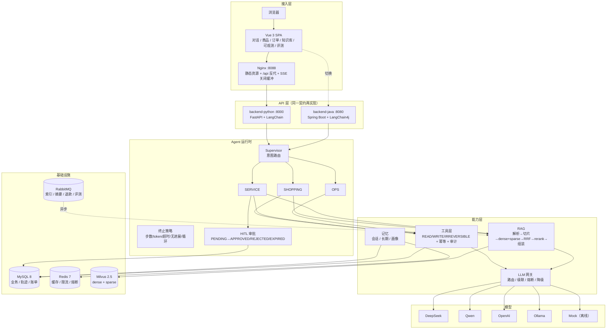

# 星图商城 · 电商智能体平台（Xingtu Ecom Agent）

> 一套前端 + 两套等价后端（Python / Java），把**导购、售后、经营分析**三条业务链收敛到同一套可审计、可人工接管、可离线演示的 Agent 平台上。

| 项 | 值 |
|---|---|
| 形态 | Web 控制台（Vue 3）+ FastAPI(:8000) / Spring Boot(:8080) + MySQL / Redis / RabbitMQ / Milvus |
| 核心能力 | 4 类 Agent、12 个工具、混合检索 RAG、退款人工审批、全链路 Trace、pass@k/pass^k 评测 |
| 默认模式 | **完全离线**（`MOCK_LLM=true` + `EMBEDDING_PROVIDER=hash`），零 API Key 可跑通 |
| 演示账号 | `admin` / `alice` / `bob`，密码统一 `Passw0rd!` |
| 文档 | [产品架构](docs/01-产品架构.md) · [技术架构](docs/02-技术架构.md) · [API 契约](docs/03-API契约.md) · [数据库设计](docs/04-数据库设计.md) · [测试用例](docs/05-测试用例.md) · [部署运维](docs/06-部署运维.md) · [知识点覆盖矩阵](docs/07-知识点覆盖矩阵.md) · [知识点详解（双语言）](docs/08-Agent知识点详解/README.md) · [Agent 通用能力框架](docs/10-Agent通用能力框架.md) |

---

## 1. 它解决什么问题

| 角色 | 痛点 | 平台怎么解 |
|---|---|---|
| 消费者 | 不会看参数、政策看不懂、退款进度不透明 | 自然语言选品与对比、政策问答带引用、订单/物流/退款资格秒级判定 |
| 客服坐席 | 反复查政策、手工核单、怕批错 | 审批卡片带订单/金额/资格/政策依据，一键批/拒，全程留痕 |
| 运营 | 文档更新后模型还用旧版、不知道为何答错 | 上传即索引、检索调试看 dense/sparse/rerank 分数、失败 job 可见 |
| 管理员 | 成本不可归因、双后端漂移、故障难复现 | 成本按模型聚合、契约测试锁结构、Trace 快照可重放 |

### 设计红线

1. **只读优先**：能用 `READ` 工具解决的绝不升级为写操作。
2. **写操作必审批**：退款（`IRREVERSIBLE`）一律先挂起、后执行，审批人必须是任务归属人。
3. **无据不答**：商品参数来自工具返回，政策结论来自检索片段并附引用。
4. **可离线**：Mock LLM + hash embedding 让 CI 与首次体验零成本、零外网。

---

## 2. 架构



**分层职责**：接入层只渲染与解析 SSE；API 层只做鉴权/校验/编排；Agent 运行时管循环、路由、终止、审批；能力层管 LLM/RAG/工具/记忆；基础设施无业务语义。
详见 [技术架构](docs/02-技术架构.md)。

---

## 3. 目录结构

```
ecom-agent/
├── backend-python/                     # FastAPI + LangChain 1.5（Python 3.12）
│   ├── app/
│   │   ├── agents/                     # 运行时 / Supervisor / 终止策略 / Prompt
│   │   ├── api/routes/                 # auth / chat / products / orders / knowledge / admin / system
│   │   ├── common/                     # 信封 / 错误码 / token 估算 / trace 上下文 / ID
│   │   ├── eval/                       # 数据集 / judge / runner（pass@k、pass^k）
│   │   ├── hitl/                       # 审批创建、决策、执行、过期
│   │   ├── infra/                      # DB / Redis / RabbitMQ / Milvus 网关 / 数据模型
│   │   ├── llm/                        # 供应商 / 路由 / 熔断 / 成本 / Mock
│   │   ├── mcp/                        # MCP 工具网关（SDK + HTTP 两种形态）
│   │   ├── memory/                     # 会话 / 长期 / 用户画像
│   │   ├── mq/                         # 索引 / 删除 / 摘要 / 退款 / 评测 消费者
│   │   ├── obs/                        # 结构化日志 / Prometheus 指标 / Trace
│   │   ├── rag/                        # 解析 / 切片 / 嵌入 / 稀疏 / 混合检索 / 重排 / 组装 / 入库
│   │   ├── security/                   # JWT / RBAC / 注入检测 / PII / 限流
│   │   ├── skills/                     # SKILL.md 加载器 + 内置技能
│   │   └── tools/                      # 12 个工具 + 风险分级执行器
│   ├── eval_data/                      # shopping / service / rag 评测集（jsonl）
│   ├── tests/                          # 73 个单元/集成用例
│   ├── scripts/                        # seed_demo.py / run_eval.py
│   ├── Dockerfile · requirements.txt · pyproject.toml · .env.example
│
├── backend-java/                       # Spring Boot 3.3.5 + LangChain4j（JDK 17）
│   ├── src/main/java/com/xingtu/agent/
│   │   ├── agent/                      # AgentRuntime / Supervisor / 终止策略 / SSE Sink
│   │   ├── api/                        # Controller + DTO（7 个）
│   │   ├── common/ config/             # 信封 / 异常 / 配置 / 线程池 / MQ / Redis
│   │   ├── eval/ hitl/ memory/ mq/     # 评测 / 审批 / 记忆 / 消费者
│   │   ├── infra/                      # JdbcTemplate / Milvus REST / 17 个 Repository
│   │   ├── llm/ obs/                   # 供应商 / 熔断 / 成本 / Trace / 指标
│   │   ├── rag/ security/ service/ tool/  # RAG / 安全 / 退款服务 / 工具
│   ├── src/test/java/...               # 12 个单元/集成测试类
│   ├── Dockerfile · pom.xml · .env.example
│
├── frontend/                           # Vue 3 + Vite + TS + Pinia + Element Plus
│   ├── src/
│   │   ├── api/ views/ components/     # 对话 / 商品 / 订单 / 知识库 / 可观测 / 评测 / 设置
│   │   ├── layouts/ router/ stores/    # 布局、路由守卫、登录态/会话/UI 状态
│   │   ├── types/ utils/ styles/       # 类型、SSE 解析、Markdown、样式
│   ├── package.json · vite.config.ts · Dockerfile · nginx.conf
│
├── deploy/
│   ├── docker-compose.yml              # 全栈：6 中间件 + 2 后端 + 前端
│   ├── docker-compose.infra.yml        # 仅中间件（本地裸跑后端）
│   ├── .env.example                    # 唯一配置入口
│   ├── mysql/init/{01-schema.sql,02-seed.sql}
│   ├── nginx/{Dockerfile,nginx.conf}   # 静态站点 + SSE 反代 + 切流说明
│   └── scripts/{up,down}.{sh,ps1} · {logs,reset}.sh
│
├── docs/                               # 00 约定 / 01 产品 / 02 技术 / 03 API / 04 DB / 05 测试 / 06 部署 / 07 覆盖矩阵
└── README.md
```

---

## 4. 三条命令快速开始

前提：Docker 24+（含 Compose v2），内存 ≥ 8GB；首次构建需外网。

### Linux / macOS / WSL

```bash
cd deploy && cp .env.example .env          # 1) 配置（默认 MOCK_LLM=true，零 Key）
./scripts/up.sh --build                    # 2) 构建并启动全栈（首次 5–10 分钟）
./scripts/logs.sh --tail 100               # 3) 看日志，出现"启动完成"即就绪
```

### Windows PowerShell

```powershell
cd deploy; Copy-Item .env.example .env
.\scripts\up.ps1 -Build
docker compose logs -f --tail 100
```

打开 **http://localhost:8088**，用 `alice / Passw0rd!` 登录。

| 自检 | 地址 | 期望 |
|---|---|---|
| 前端 | http://localhost:8088 | 登录页 |
| Python 健康 | http://localhost:8000/health | `status=UP`（Milvus 首启可能 `DEGRADED`） |
| Java 健康 | http://localhost:8080/health | 同上 |
| RabbitMQ 控制台 | http://localhost:15672 | `ecom / ecom123` |
| MinIO 控制台 | http://localhost:9001 | `minioadmin / minioadmin123` |
| 指标 | http://localhost:8000/metrics | 含 `ecom_agent_*` |

> 首次启动 Milvus 需 60–120s；期间后端会重试等待。停止：`./scripts/down.sh`；**清空数据**：`./scripts/reset.sh --yes`。

---

## 5. 默认账号

| 账号 | 密码 | 角色 | 用途 |
|---|---|---|---|
| `admin` | `Passw0rd!` | `ADMIN,OPS` | 知识库、可观测、评测、审批（演示中代行坐席） |
| `alice` | `Passw0rd!` | `USER` | 主演示用户：4 笔订单、1 条待审批退款、偏好画像 |
| `bob` | `Passw0rd!` | `USER` | 越权对照：查不到 alice 的订单，用于安全演示 |

> 密码为 bcrypt `$2a$12$` 哈希（`02-seed.sql`），Python/Java 两端均可校验。生产必须重置。
> 数据规模：3 用户 / 2 类目 / 8 商品 / 6 订单（覆盖 6 种状态）/ 4 条物流 / 2 条退款 / 2 条审批 / 8 篇知识文档 / 2 个评测批次。

---

## 6. 两套后端

| 维度 | Python | Java |
|---|---|---|
| 栈 | FastAPI 0.121 + LangChain 1.5 + LangGraph + SQLAlchemy 2 | Spring Boot 3.3.5 + LangChain4j 1.24 + JdbcTemplate |
| 端口 | 8000 | 8080 |
| 入口 | `app/main.py:app` | `com.xingtu.agent.AgentApplication` |
| Milvus 接入 | pymilvus SDK | REST v2 |
| 构建 | `docker compose build backend-python` | `docker compose build backend-java` |
| 本地运行 | `uvicorn app.main:app --port 8000` | `mvn spring-boot:run`（需 JDK 17 + Maven） |

**两套后端不是主备，而是同一份契约的两个独立实现**，用于验证架构可移植性。切换方式：

1. **nginx（推荐）**：把 `deploy/nginx/nginx.conf` 中两处 `proxy_pass http://backend_python;` 改为 `http://backend_java;`，`nginx -s reload`；
2. **前端切换器**：顶栏选择 Java（写入 `apiBase`），页面会刷新；
3. **直连**：`VITE_BACKEND_JAVA=http://localhost:8080/api/v1`（仅联调）。

一致性由四道锁保证：契约文档、共用 DDL、枚举硬编码、契约测试。允许的差异仅限语言惯用法、Milvus 接入方式、ORM 方式；**HTTP 路径、字段名、枚举、SSE 事件名、状态机转移必须逐字节一致**。详见 [技术架构](docs/02-技术架构.md) 与 [API 契约](docs/03-API契约.md)。

---

## 7. Mock 离线模式

默认 `deploy/.env` 即为离线配置，**不需要任何 API Key**：

| 配置 | 值 | 作用 |
|---|---|---|
| `MOCK_LLM` | `true` | 强制走确定性 Mock 模型：意图识别、工具调用 JSON、推荐/售后话术都由规则生成，不发外网请求 |
| `EMBEDDING_PROVIDER` | `hash` | 1024 维确定性哈希向量，无需嵌入 API |
| `RERANK_PROVIDER` | `llm` | Mock 模式下由本地打分完成；也可设 `none` 直接按 RRF 截断 |
| `VECTOR_STORE` | `auto` | Milvus 可用则用 Milvus，否则内存向量 + MySQL 全文 |
| `MQ_ENABLED` | `true` | MQ 不可用时自动落 `async_task`，由本地 drainer 兜底 |

| 离线能做什么 | 离线做不到什么 |
|---|---|
| 登录、会话、SSE 全事件流 | 真实语义理解（Hash 向量质量有限） |
| 商品/订单/物流/知识检索与引用 | 真实 LLM 的话术多样性与推理能力 |
| 退款审批全链路（挂起→批准→执行） | 真实的模型级联与成本数据（Mock 成本为 0） |
| 知识上传→索引→检索→评测 | 跨语言/跨领域泛化 |
| 可观测（trace/成本/指标）与评测批次 | — |

切到真实模型：`MOCK_LLM=false`，填 `DEEPSEEK_API_KEY`（或 `DASHSCOPE_API_KEY`），`EMBEDDING_PROVIDER=dashscope`，重启后端即可；无需改代码。

---

## 8. 文档索引

| 文档 | 内容 | 适合谁 |
|---|---|---|
| [00-开发约定](docs/00-开发约定.md) | 仓库结构、环境变量、命名规范、Agent/工具/终止条件约定、端口 | 全员，先读 |
| [01-产品架构](docs/01-产品架构.md) | 定位边界、角色画像、14 个核心场景、功能优先级、HITL 设计、指标、路线图 | 产品/业务/测试 |
| [02-技术架构](docs/02-技术架构.md) | 分层、双后端一致性、时序、Agent 运行时、LLM 网关、RAG、记忆、降级矩阵、安全 | 后端/架构 |
| [03-API契约](docs/03-API契约.md) | 统一信封、错误码、全部接口、SSE 事件序列、MQ 事件 | 前后端/测试 |
| [04-数据库设计](docs/04-数据库设计.md) | 设计原则、表清单、ER、关键决策、索引理由、Milvus 集合、Redis Key、生命周期 | 后端/DBA |
| [05-测试用例](docs/05-测试用例.md) | 金字塔、准入准出、65 单元 + 43 集成 + 18 契约 + 28 验收 + 18 安全 + 性能 + 评测集设计 | 测试/开发 |
| [06-部署运维](docs/06-部署运维.md) | 环境要求、拓扑端口、三条命令、双后端切换、配置、初始化、Milvus、6 类故障手册、备份扩容灰度回滚、监控告警 | 运维/开发 |
| [07-知识点覆盖矩阵](docs/07-知识点覆盖矩阵.md) | 95 个知识点 → 真实代码路径、覆盖程度、未实现清单、需复核差距 | 评审/主程 |
| [08-知识点详解（双语言）](docs/08-Agent知识点详解/README.md) | 知识大纲落地版：每个知识点给「要点 → Python 实现 → Java 实现 → 坑/差异」，5 册 40+ 条对照 | 学习/面试/代码评审 |
| [10-Agent通用能力框架](docs/10-Agent通用能力框架.md) | 6 层 18 个能力域的通用框架 + 逐项实现状态与成熟度（L0–L4）+ 10 段核心代码 | 架构评审/能力盘点 |
| [11-代码能力标注规范](docs/11-代码能力标注规范.md) | 两层标注体系：**251 个 Python/Java 文件 100% 覆盖**的文件级横幅 + 79 个函数级注释块（18 域），含 grep 速查 | 开发/评审 |

---

## 9. 当前状态（诚实说明）

| 项 | 状态 |
|---|---|
| 双后端 + 前端 + 部署编排 | 已完成（`docker-compose.yml` 可编排 9 个服务） |
| Python 单元/集成测试 | **126 个用例**（`backend-python/tests/`，全 Mock，实测全绿） |
| Java 编译 | **已通过**：`javac --release 17` 编译 147 个文件（135 main + 12 test），0 error |
| Java 单元/集成测试 | 12 个测试类 / **69 个用例**；本机 JDK 25 下 49 通过、20 个因 Mockito 不支持 JDK 25 无法运行（项目目标 JDK 17） |
| 契约/安全/性能测试 | 已设计（见 05），**脚本尚未落地** |
| 知识点覆盖 | 完整 55 / 部分 22 / 仅文档 2 / 未覆盖 16（共 95，加权 ≈ 69.5%） |
| 训练与推理优化 | SFT / LoRA / DPO / 量化 / 剪枝 / 蒸馏 / vLLM / SGLang **未覆盖**；Ollama 仅配置项 |
| 图谱能力 | 知识图谱 / Ontology / Text2Cypher / GraphRAG **未覆盖**（GraphRAG 仅路线图） |

**已修复（本轮集成校验）**：审批支持 ADMIN/OPS 代客审批（A-11 可过）、双端切片默认值统一 400、Skill 已接入 runtime（渐进式披露）、审批后执行走 `approved_func`（原实现会死循环）、双端熔断阈值统一 3 次/30s。

**仍未关闭**：契约/安全/性能脚本（G1）、知识更新后检索缓存失效（G3）、审批超时口径（G7）、Java 沙箱强度（G8）、checkpoint 恢复入口（G9）、审批金额阈值语义（G10）、前端 lockfile（G11）。完整清单见 [06 §11](docs/06-部署运维.md) 与 [07 §8](docs/07-知识点覆盖矩阵.md)。

---

## 10. 技术选型速览

| 选择 | 理由 |
|---|---|
| 一套前端 + 两套后端 | 用契约测试验证架构可移植性；团队可按语言栈分工 |
| Milvus（dense+sparse） | 原生混合检索，RRF 融合无需自建 |
| RabbitMQ | 索引/摘要/退款/评测都是异步任务，需可靠投递与死信 |
| SSE 而非 WebSocket | 单向流足够，HTTP 语义简单，易过网关 |
| Mock LLM + hash embedding | 无密钥可跑通、CI 可测、演示零成本 |
| JdbcTemplate（Java） | 无 ORM 魔法，SQL 可控，降低双端漂移面 |
