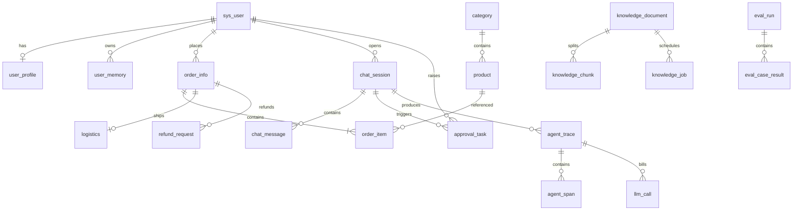

# 数据库设计

> DDL 事实源：`deploy/mysql/init/01-schema.sql`。本文解释**为什么这么设计**。
> 两套后端（Python / Java）共用同一份库，任何字段变更必须同步两端实体与本文。

---

## 1. 设计原则

| 原则 | 落地方式 |
|---|---|
| 单一事实源 | 业务状态只存 MySQL，Redis 只做缓存/限流/锁，不存唯一真相 |
| 可追溯 | 每个写操作有 `created_at`/`updated_at`；关键动作进 `audit_log` |
| 可重放 | Agent 每步落 `agent_checkpoint`，能从任意步恢复 |
| 成本可归因 | 每次模型调用落 `llm_call`，关联 `trace_id` |
| 软删除 | 仅知识文档用 `deleted_at`（需支持撤销与重建索引）；其余物理删除 |
| 幂等 | 有副作用的外部动作带 `idempotency_key` 唯一索引 |
| JSON 慎用 | 只用于"结构不定且不需索引"的字段（attrs、payload、metadata） |

---

## 2. 表清单（25 张）

| 域 | 表 | 说明 |
|---|---|---|
| 身份 | `sys_user` | 用户与角色 |
| | `user_profile` | 用户画像（结构化长期记忆） |
| | `user_memory` | 长期记忆条目（非结构化） |
| 商品 | `category` | 类目树 |
| | `product` | 商品 SPU，带 ngram 全文索引 |
| 交易 | `order_info` | 订单主表 |
| | `order_item` | 订单明细 |
| | `logistics` | 物流单与轨迹 |
| | `refund_request` | 退款申请（幂等键唯一） |
| 会话 | `chat_session` | 会话与滚动摘要 |
| | `chat_message` | 消息、工具调用、引用、token、成本 |
| | `approval_task` | 人工审批任务 |
| 知识 | `knowledge_document` | 文档元数据（软删除） |
| | `knowledge_chunk` | 切片与父块内容 |
| | `knowledge_job` | 索引作业进度 |
| 可观测 | `agent_trace` | 链路根节点 |
| | `agent_span` | 链路 span（LLM/TOOL/RETRIEVAL/AGENT/GUARDRAIL） |
| | `llm_call` | 模型调用账单 |
| | `audit_log` | 审计 |
| 评测 | `eval_run` | 评测批次（含 pass^k） |
| | `eval_case_result` | 用例结果 |
| 运行时 | `idempotency_record` | 幂等结果缓存 |
| | `async_task` | MQ 落库兜底与死信 |
| | `agent_checkpoint` | 长任务检查点 |
| | `prompt_template` | Prompt 版本管理 |

---

## 3. 核心 ER



---

## 4. 关键设计决策

### 4.1 为什么 `chat_message.tool_calls` / `citations` 用 JSON
工具调用是"一轮内可多次、结构随工具而变"的数据，拆表会导致一次对话写入 N 行且查询时几乎总是整体读取。用 JSON 存 + 内存反序列化，配合 `trace_id` 关联完整 span，足够。

### 4.2 为什么单独建 `agent_trace` / `agent_span`
- 排查问题时按 `session_id` 找 trace、按 `trace_id` 拉全量 span，是最频繁的查询。
- `agent_span.input/output` 存完整快照，支撑**确定性重放**：把 LLM 与工具返回值固定后重跑同一轨迹。
- 不塞进 `chat_message` 是因为一条消息可能产生 20+ span，且 span 需要独立保留期。

### 4.3 `llm_call` 与 `agent_span` 的关系
一个 span 可能包含多次模型调用（重试 / 级联升级）。`llm_call` 只记"钱"，`span` 记"链路"。成本聚合走 `llm_call`，性能聚合走 `agent_span`。

### 4.4 幂等设计
| 场景 | 幂等键 | 实现 |
|---|---|---|
| 退款申请 | `order_id + reason_hash + 用户当日序号` | `refund_request.uk_refund_idem` 唯一索引，重复键返回已有记录 |
| 知识入库 | `document.checksum` | 相同内容不重复切分，仅更新版本 |
| 通用外部动作 | 客户端传入 `idempotency_key` | `idempotency_record` 先查后插，冲突返回缓存结果 |

> 注意：`INSERT ... ON DUPLICATE KEY UPDATE` 适合**结果缓存**（`idempotency_record` 这类"写谁都一样"的表，Java 端即如此）；
> 但**业务唯一键**（如 `refund_request.idempotency_key`）必须用"先 `SELECT` 再 `INSERT` + 捕获唯一键异常"，
> 否则 upsert 会把真实的并发冲突静默覆盖掉，退款可能被重复创建却看不出来。

### 4.5 审批与退款的状态机
`refund_request.status` 与 `approval_task.status` 是两个独立的生命周期：

```
approval_task:  PENDING ──approve──> APPROVED
                    │
                    ├──reject───> REJECTED
                    └──timeout──> EXPIRED

refund_request: PENDING_APPROVAL ──(approval APPROVED)──> PROCESSING ──> SUCCESS
                                └──(approval REJECTED/EXPIRED)──> REJECTED
                                                          PROCESSING ──失败──> FAILED
```

**只允许 `APPROVED` 的审批触发退款执行**，且执行由 MQ 消费者完成（可重试、可补偿），不在 HTTP 请求线程里做。

### 4.6 为什么要 `agent_checkpoint`
长任务（多步工具调用、等待审批）可能在任意步中断。`agent_checkpoint` 保存每步的 `state` JSON：
- 恢复：取该 trace 最后一条 checkpoint，重建消息历史与已完成步骤，跳过已执行工具（幂等）。
- 重放：按 `step_no` 顺序回放，用于调试与回归。

`uk_ckpt(trace_id, step_no)` 保证重试不产生重复检查点。

### 4.7 `async_task` 与 RabbitMQ 的关系
RabbitMQ 负责**投递**，`async_task` 负责**留痕**。消息消费失败重试 3 次后：
1. `async_task.status = 'DEAD'`
2. 打点到 `ecom_agent_async_task_dead_total`
3. 告警

这样即使 MQ 消息丢失，也能从库表补偿。

### 4.8 全文索引与中文
`product` 的 `FULLTEXT KEY ft_product (...) WITH PARSER ngram`：
- 中文必须用 ngram 解析器，默认分词器会把整句当一个词。
- ngram token size 默认 2，适合中文短语；英文关键词仍可命中。
- 这是 Milvus 不可用时的**降级检索通道**，不是主通道。

---

## 5. 索引设计理由

| 索引 | 支撑的查询 |
|---|---|
| `idx_order_user(user_id, status, created_at DESC)` | "我的订单"按状态筛选 + 时间倒序，覆盖最频繁路径 |
| `idx_msg_session(session_id, id)` | 会话消息顺序拉取，`id` 自增即时间序 |
| `idx_span_trace(trace_id, seq)` | trace 详情按执行顺序展开 |
| `idx_llm_model(model, created_at)` | 成本与延迟按模型聚合 |
| `idx_mem_user(user_id, mem_type, importance DESC)` | 长期记忆检索时优先取高重要性 |
| `idx_approval_user(user_id, status)` | 待办审批列表 |
| `uk_refund_idem` | 幂等的强保障 |

> 没有给 `chat_message.content` 建全文索引：消息内容检索走语义检索，不需要关键词匹配。

---

## 6. Milvus 集合设计

向量维度统一 **1024**（BGE-M3 / text-embedding-v3 通用维度）。

### 6.1 `ecom_knowledge`
| 字段 | 类型 | 说明 |
|---|---|---|
| `id` | INT64, primary, autoID | 主键 |
| `chunk_id` | INT64 | 对应 `knowledge_chunk.id` |
| `document_id` | INT64 | |
| `doc_type` | VARCHAR(32) | 过滤用 |
| `visibility` | VARCHAR(32) | 权限过滤用，**检索前必须带** |
| `content` | VARCHAR(8192) | 原文，用于展示 |
| `dense` | FLOAT_VECTOR(1024) | HNSW, COSINE, M=16, efConstruction=200 |
| `sparse` | SPARSE_FLOAT_VECTOR | 倒排索引，BM25-lite 权重 |

### 6.2 `ecom_product`
| 字段 | 类型 |
|---|---|
| `id` / `product_id` / `category_id` / `price` | INT64 / INT64 / INT64 / DOUBLE |
| `sku` / `title` | VARCHAR |
| `dense` | FLOAT_VECTOR(1024) |

### 6.3 `ecom_memory`
| 字段 | 类型 |
|---|---|
| `id` / `memory_id` / `user_id` | INT64 |
| `content` | VARCHAR(2048) |
| `dense` | FLOAT_VECTOR(1024) |

### 6.4 检索策略
```
query
 ├─ dense topK=20  ─┐
 └─ sparse topK=20 ─┴─> RRF(k=60) ─> 取 top 50 ─> LLM rerank ─> top 5
                                                      └─ 父子块展开 ──> 上下文组装
```
`visibility` 与 `doc_type` 作为 `filter` 表达式**在检索前**下推，避免越权召回后再过滤。

---

## 7. Redis Key 规范

统一前缀 `ecom:`，全部设置 TTL。

| Key | 类型 | TTL | 用途 |
|---|---|---|---|
| `ecom:sess:{sessionId}:msgs` | List | 2h | 会话消息热缓存 |
| `ecom:sess:{sessionId}:state` | String(JSON) | 2h | 当前 Agent 运行状态 |
| `ecom:rl:{userId}:{minute}` | String(计数) | 70s | 滑动窗口限流 |
| `ecom:rl:ip:{ip}:{minute}` | String | 70s | IP 限流 |
| `ecom:lock:{resource}` | String(SETNX) | 30s | 分布式锁（索引任务、退款执行） |
| `ecom:circuit:{provider}` | Hash | 60s | 熔断器状态与失败计数 |
| `ecom:cache:product:{sku}` | String(JSON) | 10min | 商品详情缓存 |
| `ecom:cache:rag:{hash(query+filters)}` | String(JSON) | 5min | 检索结果缓存（知识更新时按 prefix 清除） |
| `ecom:approval:pending:{userId}` | Set | - | 待办审批 |

**知识更新时的缓存失效**：`knowledge_document` 状态变为 `READY` 后，扫描 `ecom:cache:rag:*` 并删除（量小，可直接 `SCAN` + `DEL`；量大则维护版本号后缀）。

---

## 8. 数据生命周期

| 数据 | 保留期 | 处理 |
|---|---|---|
| `chat_message` | 180 天 | 归档到冷存储后删除 |
| `agent_span` | 30 天 | 明细清理，保留 `agent_trace` 汇总 |
| `agent_checkpoint` | 7 天 | 仅用于短期恢复与调试 |
| `llm_call` | 1 年 | 账单审计需要 |
| `audit_log` | 3 年 | 合规要求，不可删 |
| `eval_*` | 1 年 | |
| `knowledge_chunk` | 随文档 | 软删除后异步清理向量 |

定时任务建议：每日 03:00 清理过期数据，Prometheus 暴露各表行数用于容量预测。

---

## 9. 与两套后端的映射约定

| 概念 | Python (SQLAlchemy) | Java (JdbcTemplate) |
|---|---|---|
| 时间 | `datetime` | `LocalDateTime` |
| DECIMAL | `Decimal` | `BigDecimal` |
| JSON 字段 | `JSON` 列类型 | `String` + Jackson 手动序列化 |
| 自增主键 | `autoincrement=True` | `GeneratedKeyHolder` |
| 布尔 | `Boolean` | 映射 `TINYINT` 为 `Integer` 再判 `!= 0` |

> Java 侧刻意不为 JSON 字段写 TypeHandler：一期用 `String` 存取，减少 ORM 复杂度与出错面。
