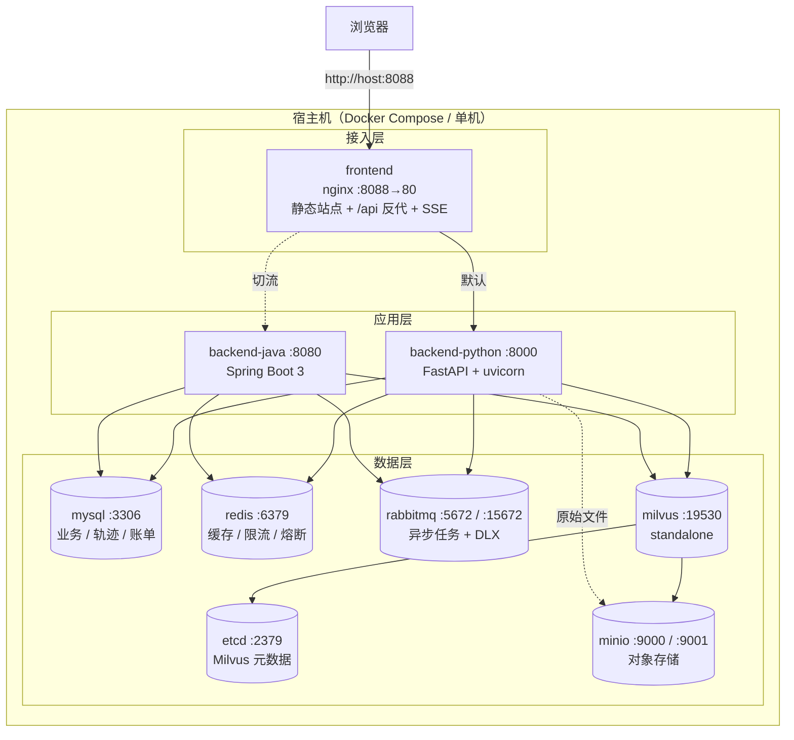

# 部署运维

> 目标：**三条命令起全栈、两套后端可切换、故障有手册、发布可回滚**。
> 事实源：`deploy/docker-compose.yml`、`deploy/docker-compose.infra.yml`、`deploy/.env.example`、`deploy/nginx/nginx.conf`、`deploy/mysql/init/*.sql`。
> 本文出现的端口、变量名、集合名以这些文件为准；改动请同步本文件与 `docs/00-开发约定.md` §7。

---

## 1. 环境要求

### 1.1 宿主机

| 项 | 最低 | 推荐 | 说明 |
|---|---|---|---|
| OS | Windows 10/11 + WSL2、macOS 13、Ubuntu 22.04 | Ubuntu 22.04 / Debian 12 | Windows 需 Docker Desktop 的 WSL2 后端 |
| Docker | 24.0 | 27+ | 需 Compose v2（`docker compose`） |
| CPU | 4 核 | 8 核 | Milvus + 两套后端 + 前端编译 |
| 内存 | 8 GB | 16 GB | MySQL 512M buffer + Milvus + 两个 JVM/Python |
| 磁盘 | 15 GB | 50 GB | 镜像约 4–5 GB，Milvus/MinIO 随知识量增长 |
| 网络 | 首次构建需外网 | — | 拉镜像与依赖；运行期可完全离线 |

### 1.2 开发工具链（非容器方式）

| 工具 | 版本 | 用途 |
|---|---|---|
| Python | 3.12 | Python 后端（`requires-python >= 3.12`） |
| JDK | 17 | Java 后端（`maven.compiler.release=17`） |
| Maven | 3.9+ | Java 构建（当前宿主机未安装 `mvn`，需自行安装或用容器构建） |
| Node.js | ≥ 18.18（`package.json engines`） | 前端构建；建议 20 LTS |
| pnpm / npm | npm 10+ | 前端依赖安装 |

### 1.3 各服务资源配置

| 服务 | 镜像 | CPU | 内存 | 磁盘 | 说明 |
|---|---|---|---|---|---|
| `mysql` | `mysql:8.0.39` | 2 | 1.5 GB | 5 GB+ | `--innodb-buffer-pool-size=512M`、`max_connections=500`、utf8mb4 |
| `redis` | `redis:7.2-alpine` | 0.5 | 512 MB | 1 GB | `appendonly yes`、`maxmemory 512mb`、`allkeys-lru` |
| `rabbitmq` | `rabbitmq:3.13-management-alpine` | 1 | 512 MB | 1 GB | 索引/摘要/退款/评测四类队列 + DLX |
| `etcd` | `quay.io/coreos/etcd:v3.5.5` | 0.5 | 256 MB | 512 MB | 仅 Milvus 元数据 |
| `minio` | `minio/minio:RELEASE.2023-03-20...` | 1 | 512 MB | 10 GB+ | Milvus 对象存储 + 知识原文 |
| `milvus` | `milvusdb/milvus:v2.5.4` | 2 | 4 GB | 10 GB+ | standalone，首启动 60–120s |
| `backend-python` | 自建 `python:3.12-slim` | 1 | 512 MB | — | uvicorn 2 worker |
| `backend-java` | 自建多阶段（`maven:3.9-eclipse-temurin-17` → `eclipse-temurin:17-jre`） | 1 | 1.5 GB | — | `-Xms512m -Xmx1024m` |
| `frontend` | `nginx:1.27-alpine` | 0.5 | 128 MB | — | 静态站点 + 反代 + SSE |

---

## 2. 拓扑与端口

### 2.1 部署拓扑



- 所有服务在同一 bridge 网络 `ecom-net`，服务名即 DNS。
- 两套后端**不是主备**：共用同一套中间件与同一份 DDL，仅监听端口不同；nginx 或前端决定流量走向。
- 数据卷全部命名持久化（`xingtu-*-data`），`down` 不丢数据，`reset.sh --yes` 才会清空。

### 2.2 端口表

| 服务 | 容器内 | 宿主机默认 | 变量 | 暴露面 |
|---|---|---|---|---|
| frontend | 80 | **8088** | `FRONTEND_PORT` | 对外 |
| backend-python | 8000 | **8000** | `APP_PORT_PYTHON` | 可选对外（联调） |
| backend-java | 8080 | **8080** | `APP_PORT_JAVA` | 可选对外（联调） |
| mysql | 3306 | 3306 | `MYSQL_HOST_PORT` | 仅内网（生产建议不映射） |
| redis | 6379 | 6379 | `REDIS_HOST_PORT` | 仅内网 |
| rabbitmq | 5672 / 15672 | 5672 / 15672 | `RABBITMQ_HOST_PORT` / `RABBITMQ_MGMT_PORT` | 15672 控制台仅内网 |
| milvus | 19530 / 9091 | 19530 / 9091 | `MILVUS_HOST_PORT` / `MILVUS_METRICS_PORT` | 19530 仅内网 |
| minio | 9000 / 9001 | 9000 / 9001 | `MINIO_HOST_PORT` / `MINIO_CONSOLE_PORT` | 9001 控制台仅内网 |
| etcd | 2379 | 2379 | `ETCD_HOST_PORT` | 仅内网 |

> 端口冲突时只改 `.env` 里的 `*_HOST_PORT`，**不要改容器内端口**（nginx upstream 与 compose 健康检查写死容器端口）。

---

## 3. 三条命令快速开始

### 3.1 Linux / macOS / WSL

```bash
cd deploy && cp .env.example .env          # 1) 准备配置（默认 MOCK_LLM=true，零 Key 可跑）
./scripts/up.sh --build                    # 2) 构建并启动全栈（首次约 5–10 分钟）
./scripts/logs.sh --tail 100               # 3) 跟踪日志，看到 "启动完成" 即就绪
```

### 3.2 Windows PowerShell

```powershell
cd deploy; Copy-Item .env.example .env
.\scripts\up.ps1 -Build
Get-Content .\logs\stack.log -Tail 100 -Wait   # 或 docker compose logs -f
```

### 3.3 启动后自检

| 检查 | 命令 | 期望 |
|---|---|---|
| 前端 | 浏览器打开 `http://localhost:8088` | 登录页；用 `alice / Passw0rd!` 可登录 |
| Python 健康 | `curl http://localhost:8000/health` | `{"status":"UP","components":{...}}` |
| Java 健康 | `curl http://localhost:8080/health` | 同上 |
| 依赖组件 | 同上响应中的 `components` | mysql/redis/rabbitmq/milvus 均 `UP`（Milvus 首启可能 `DOWN`，等 60–120s） |
| 队列 | `http://localhost:15672`（ecom/ecom123） | 5 个业务队列 + 5 个 DLX 队列，无堆积 |
| 指标 | `curl http://localhost:8000/metrics | Select-String ecom_agent_` | 有 `ecom_agent_requests_total` 等 |
| 数据 | 登录后看订单/商品 | 6 单、8 商品、2 条待办审批 |

> 首次启动 Milvus 需要 60–120 秒；期间后端健康检查可能失败但不会退出（`restart: unless-stopped` + 依赖 `service_healthy` 会等）。

### 3.4 仅启动中间件（本地裸跑后端）

```bash
cd deploy && ./scripts/up.sh --infra        # 只起 mysql/redis/rabbitmq/etcd/minio/milvus
cd ../backend-python && uvicorn app.main:app --host 0.0.0.0 --port 8000 --reload
cd ../backend-java && mvn spring-boot:run    # 需 JDK 17 + Maven
cd ../frontend && npm ci && npm run dev      # Vite :5173，代理到 8000
```

---

## 4. 双后端构建与切换

### 4.1 构建

| 后端 | 命令 | 产物 | 备注 |
|---|---|---|---|
| Python | `docker compose build backend-python` | 镜像 `xingtu/ecom-backend-python:${IMAGE_TAG}` | 多阶段：venv + 运行时；`CMD uvicorn app.main:app --workers 2` |
| Python（本地） | `pip install -r requirements.txt && uvicorn app.main:app --port 8000` | — | 需 Python 3.12 |
| Java | `docker compose build backend-java` | 镜像 `xingtu/ecom-backend-java:${IMAGE_TAG}` | 多阶段构建；运行镜像含 curl 供 healthcheck |
| Java（本地） | `mvn -DskipTests package && java -jar target/ecom-agent-java.jar` | 可执行 jar | `finalName=ecom-agent-java` |
| 前端 | `docker compose build frontend` | `xingtu/ecom-frontend:${IMAGE_TAG}` | 构建上下文是**仓库根**，Dockerfile 在 `deploy/nginx/` |

### 4.2 切换方式（4 种，按推荐顺序）

| 方式 | 操作 | 生效 | 适用 |
|---|---|---|---|
| **1. nginx 改 upstream（推荐）** | 把 `deploy/nginx/nginx.conf` 中两处 `proxy_pass http://backend_python;` 改为 `http://backend_java;` | `docker compose exec frontend nginx -t && docker compose exec frontend nginx -s reload` | 整站切流，前端无需改 |
| 2. 交换 upstream server | 把 `upstream backend_python` 里的 `server backend-python:8000` 换成 `backend-java:8080` | reload | 前端与 API base 都不动，回滚最快 |
| 3. 前端切换器 | 顶栏 `BackendSwitcher` 选 Java（写入 localStorage 的 `apiBase`） | 立即（页面刷新） | 联调对比，浏览器级 |
| 4. 直连端口 | 前端 `VITE_BACKEND_JAVA=http://localhost:8080/api/v1` | 重新构建/刷新 | 仅本地调试，生产不要长期用 |

### 4.3 切换后验证

```bash
curl -s http://localhost:8000/api/v1/meta/capabilities | jq '.data.backend'   # "python"
curl -s http://localhost:8080/api/v1/meta/capabilities | jq '.data.backend'   # "java"
```

| 校验项 | 期望 |
|---|---|
| `backend` 字段 | 与实际后端一致（`python` / `java`） |
| `version` | 两端一致 |
| `features` | `approval/replay/hybridRag/text2sql` 均为 true |
| `limits` | `maxSteps/maxTokenBudget/taskTimeoutSeconds` 与 `.env` 一致 |
| 登录 + 会话 | 两端都能登录并拉到同一批种子数据（同一 MySQL） |
| SSE | `done.finishReason` 枚举一致；事件序列一致 |

> ⚠️ 切换前必须确认两端读取的是**同一份** `MILVUS_COLLECTION_PREFIX`、`EMBEDDING_DIM=1024` 与同一数据库；否则会出现"切过去搜不到"。

---

## 5. 配置项

**唯一入口**：`deploy/.env.example` → 复制为 `deploy/.env`；compose 用它做变量插值并注入两个后端容器。
本地裸跑时，Python 读 `backend-python/.env`（字段见 `backend-python/.env.example`），Java 读环境变量（见 `backend-java/.env.example`）。

| 组 | 关键变量 | 默认 | 说明 |
|---|---|---|---|
| 通用 | `COMPOSE_PROJECT_NAME` / `APP_ENV` / `TZ` / `IMAGE_TAG` | `xingtu-ecom` / `dev` / `Asia/Shanghai` / `dev` | 项目名决定网络与卷复用；`IMAGE_TAG` 用于灰度 |
| 端口 | `FRONTEND_PORT` / `APP_PORT_*` / `*_HOST_PORT` | 8088 / 8000 / 8080 / … | 只影响宿主机映射 |
| MySQL | `MYSQL_ROOT_PASSWORD` / `MYSQL_DATABASE` / `MYSQL_DB` / `MYSQL_USER` / `MYSQL_PASSWORD` | `root123` / `ecom_agent` / `ecom_agent` / `ecom` / `ecom123` | `MYSQL_DATABASE` 与 `MYSQL_DB` 必须一致 |
| Redis | `REDIS_HOST/PORT/PASSWORD/DB` | `redis/6379/ecom123/0` | 密码留空则无鉴权启动（健康检查自适应） |
| RabbitMQ | `RABBITMQ_*` | `rabbitmq/5672/ecom/ecom123/ecom` | vhost `ecom` |
| Milvus | `MILVUS_HOST/PORT` / `MILVUS_COLLECTION_PREFIX` / `MILVUS_TOKEN` | `milvus/19530` / `ecom` / 空 | 集合名 = `{prefix}_knowledge` 等 |
| MinIO | `MINIO_ENDPOINT` / `MINIO_ROOT_USER` / `MINIO_ROOT_PASSWORD` / `MINIO_BUCKET` | `http://minio:9000` / `minioadmin` / `minioadmin123` / `ecom-files` | 知识原文与 Milvus 对象共用 |
| LLM | `LLM_PRIMARY` / `MOCK_LLM` / 各 `*_API_KEY, *_MODEL` | `deepseek` / **`true`** / 空 | `MOCK_LLM=true` 时强制走 mock，忽略所有 Key |
| 向量化 | `EMBEDDING_PROVIDER` / `EMBEDDING_DIM` / `RERANK_PROVIDER` | `hash` / `1024` / `llm` | 维度三个集合统一，改动需重建集合 |
| Agent | `MAX_STEPS` / `MAX_TOKEN_BUDGET` / `TASK_TIMEOUT_SECONDS` / `APPROVAL_AMOUNT_THRESHOLD_CENTS` / `RATE_LIMIT_PER_MINUTE` | 12 / 60000 / 120 / 100000 / 30 | 终止条件 2/3/4 与限流 |
| SSE | `SSE_HEARTBEAT_SECONDS` / `LOG_LEVEL` | 15 / INFO | 心跳须小于 nginx `proxy_read_timeout` |

**仅后端支持的高级变量**（不在 compose 顶层注入，需自行加到服务环境）：

| 变量 | 默认 | 说明 |
|---|---|---|
| `VECTOR_STORE` | `auto` | `auto`/`memory`/`milvus`；CI 用 `memory` |
| `MQ_ENABLED` / `MQ_CONSUMER_ENABLED` | `true` | 关闭后靠 `async_task` 本地 drainer 兜底 |
| `DATABASE_URL` | 空 | 显式覆盖（SQLite 测试用） |
| `AUTO_CREATE_TABLES` | `false` | 仅测试/本地；生产必须 false（schema 由 SQL 管理） |
| `CORS_ORIGINS` | `*` | 生产收紧为前端域名 |
| `AGENT_ENGINE` | `native` | `native`/`langchain` |
| `LLM_FALLBACKS`（Py）/ `LLM_FALLBACK_CHAIN`（Java） | `qwen,openai` / `deepseek,qwen,qwen-turbo,openai,ollama,mock` | 兜底顺序 |
| `RAG_CHUNK_SIZE` / `RAG_CHUNK_OVERLAP`（Java） | 520 / 80 | Python 侧对应 `CHUNK_SIZE=400`、`CHUNK_OVERLAP=80`（**两端默认值不同，见 §11**） |
| `SANDBOX_ENABLED` / `PYTHON_SANDBOX_TIMEOUT` | `true` / `5.0` | `run_python` 沙箱 |

> 不要把密钥写进 `docker-compose.yml`；`.env` 不进版本库（仅提交 `.env.example`）。生产用 K8s Secret / Vault 注入同名环境变量。

---

## 6. 数据库初始化顺序

```
deploy/mysql/init/01-schema.sql   →  建库 + 25 张表 + 索引（仅首次初始化数据卷时执行）
deploy/mysql/init/02-seed.sql     →  演示数据（3 用户 / 8 商品 / 6 订单 / 审批 / 知识 / 轨迹）
```

| 项 | 说明 |
|---|---|
| 执行机制 | MySQL 官方镜像按文件名字典序执行 `/docker-entrypoint-initdb.d/*.sql`，**只在数据目录为空时**执行一次 |
| 库名 | `ecom_agent`（`CREATE DATABASE IF NOT EXISTS ... utf8mb4`） |
| 字符集 | `utf8mb4 / utf8mb4_0900_ai_ci`；`product` 带 `FULLTEXT ... WITH PARSER ngram` |
| 表数量 | **25 张**（`docs/04` 写的 26 张与实际 DDL 不符，以 `01-schema.sql` 为准） |
| 账号 | `admin`（ADMIN,OPS）、`alice`（USER）、`bob`（USER），密码统一 `Passw0rd!`（bcrypt `$2a$12$`） |
| 幂等 | 种子脚本不可重复执行（主键冲突）；重置用 `./scripts/reset.sh --yes`（删卷 → 重建） |
| 时区 | 容器 `TZ=Asia/Shanghai`；SQL `SET time_zone='+08:00'`；时间列 `DATETIME(3)` |
| 后端建表 | `AUTO_CREATE_TABLES=false`（默认）；不要用 ORM 自动建表替代 DDL |

### 6.1 初始化校验

```bash
docker compose exec mysql mysql -uecom -pecom123 -e "
  SELECT COUNT(*) AS tables_ FROM information_schema.tables WHERE table_schema='ecom_agent';
  SELECT username, roles FROM ecom_agent.sys_user;
  SELECT COUNT(*) FROM ecom_agent.product;"
```

期望：`tables_=25`；3 个用户；8 个商品。

### 6.2 重置

```bash
./scripts/reset.sh --yes     # 停栈 + 删 6 个数据卷 + 重新 up（会丢失所有数据）
./scripts/down.sh            # 仅停栈，保留数据
```

---

## 7. Milvus 集合设计

- 部署形态：standalone（etcd 存元数据、MinIO 存段文件）。
- 统一维度：**1024**（`EMBEDDING_DIM`，text-embedding-v3 / BGE-M3 通用维度）；改维度必须删集合重建。
- 集合名：`${MILVUS_COLLECTION_PREFIX}_<suffix>`，默认三个：`ecom_knowledge`、`ecom_product`、`ecom_memory`。

### 7.1 `ecom_knowledge`

| 字段 | 类型 | 约束/索引 | 说明 |
|---|---|---|---|
| `id` | INT64 | primary, autoID | 主键 |
| `chunk_id` | INT64 | — | 对应 `knowledge_chunk.id` |
| `document_id` | INT64 | — | 对应 `knowledge_document.id` |
| `doc_type` | VARCHAR(32) | 标量过滤 | `POLICY/MANUAL/FAQ/PRODUCT_DOC` |
| `visibility` | VARCHAR(32) | 标量过滤 | `PUBLIC/INTERNAL/ADMIN`，**检索前必须下推** |
| `title` | VARCHAR(512) | — | 展示与引用 |
| `content` | VARCHAR(8192) | — | 原文片段 |
| `dense` | FLOAT_VECTOR(1024) | HNSW, COSINE, `M=16`, `efConstruction=200` | 语义召回 |
| `sparse` | SPARSE_FLOAT_VECTOR | 倒排索引（BM25-lite 权重） | 关键词召回 |

### 7.2 `ecom_product`

| 字段 | 类型 | 说明 |
|---|---|---|
| `id` | INT64, primary | 主键 |
| `product_id` / `category_id` | INT64 | 关联 `product` / `category` |
| `sku` / `title` | VARCHAR | 展示 |
| `price` | DOUBLE | 价格过滤 |
| `dense` | FLOAT_VECTOR(1024) | 语义召回（商品标题+卖点） |

### 7.3 `ecom_memory`

| 字段 | 类型 | 说明 |
|---|---|---|
| `id` | INT64, primary | 主键 |
| `memory_id` / `user_id` | INT64 | 关联 `user_memory` / `sys_user` |
| `content` | VARCHAR(2048) | 记忆正文 |
| `dense` | FLOAT_VECTOR(1024) | 语义召回 |

### 7.4 检索与过滤

```
query
 ├─ dense  topK=20  ─┐
 └─ sparse topK=20  ─┴─ RRF(k=60) → top50 → LLM rerank → top5 → 父子块展开 → 上下文
filter: visibility == "PUBLIC" && doc_type in ["POLICY","FAQ"]
```

| 要点 | 做法 |
|---|---|
| 权限 | `visibility` 与 `doc_type` 作为 filter 表达式**在检索前**下推，绝不"先召回后过滤" |
| 一致性 | standalone 默认 `Bounded`；写完立即检索的场景用 `Strong`（调试接口可接受延迟） |
| 索引 | 建集合时同步建 `dense` HNSW 与 `sparse` 倒排；`load` 后才可检索 |
| 删除 | 按 `document_id` 表达式删除；软删文档后由 `knowledge.delete` 异步清理 |
| 降级 | Milvus 不可用 → MySQL `FULLTEXT ngram`（product）/ 关键词候选 + BM25-lite（chunk）→ 内存余弦 |

### 7.5 常用运维命令

```bash
# 集合是否存在/已加载（REST v2）
curl -s -X POST http://localhost:19530/v2/vectordb/collections/list \
  -H 'Content-Type: application/json' -d '{"dbName":"default"}' | jq

# 行数（用 Milvus 自带工具或 REST query）
curl -s -X POST http://localhost:19530/v2/vectordb/entities/query \
  -H 'Content-Type: application/json' \
  -d '{"collectionName":"ecom_knowledge","filter":"id > 0","outputFields":["count(*)"],"dbName":"default"}' | jq

# 健康
curl -s http://localhost:9091/healthz
```

---

## 8. 运维手册（故障排查）

> 通用四步：**看现象 → 看组件健康 → 看日志/指标 → 按降级矩阵处理**。
> 日志：`./scripts/logs.sh <service> --tail 200`；结构化字段 `ts/level/traceId/sessionId/userId/module/event/latencyMs`。

### 8.1 Milvus 连不上

| 项 | 内容 |
|---|---|
| 现象 | 对话仍可用但"知识库无结果"；`/health` 中 `milvus=DOWN`；日志 `MilvusUnavailable` / `connection refused`；`ecom_agent_degradations_total{component="retrieval"}` 增长 |
| 诊断 | `docker compose ps milvus etcd minio`；`curl localhost:9091/healthz`；`docker compose logs --tail=200 milvus`；确认宿主机 19530 未被占用 |
| 处理 | ① 等 60–120s（首启建集合）；② etcd/minio 未 healthy 时先修它们；③ `restart: unless-stopped` 会自动拉起；④ 仍失败则 `docker compose up -d --force-recreate milvus`；⑤ 生产可临时 `VECTOR_STORE=memory` 保证可用（仅内存，重启丢失） |
| 验证 | `/health` 的 milvus 回到 `UP`；`POST /knowledge/search` 有命中且 `debug.degraded=false` |
| 影响 | 降级期间召回质量下降，答案可能变短；应在 UI 提示"知识检索降级" |

### 8.2 LLM 超时 / 全部不可用

| 项 | 内容 |
|---|---|
| 现象 | 首 token 很慢或返回兜底话术"智能助手暂时不可用"；`llm_calls_total{status="ERROR"}` 上升；`circuit_state` 变 OPEN |
| 诊断 | 看 `docker compose logs backend-python | Select-String llm`；`curl /api/v1/admin/models` 看熔断；确认 `MOCK_LLM` 与 Key；外网连通性 `curl https://api.deepseek.com/v1/models` |
| 处理 | ① 单供应商故障：熔断自动切兜底（无需操作）；② 全挂：确认 Key/额度/网络；③ 临时 `MOCK_LLM=true` 重启（演示兜底）；④ 长时故障：让前端提示转人工，工单兜底 |
| 验证 | `finishReason=stop` 恢复；`llm_calls_total{status="OK"}` 增长；P95 回到阈值内 |
| 注意 | 已开始输出 delta 后失败**不会换模型重放**（避免答案前后矛盾），直接 `error` 事件 |

### 8.3 RabbitMQ 堆积

| 项 | 内容 |
|---|---|
| 现象 | 上传文档长期 `QUEUED/RUNNING`；`async_task` 出现 `PENDING` 堆积；队列 Ready 数持续上涨 |
| 诊断 | 控制台 `http://localhost:15672` 或 `docker compose exec rabbitmq rabbitmqctl list_queues name messages consumers`；看消费者线程日志 `MQ 消费者`；确认 `MQ_ENABLED/MQ_CONSUMER_ENABLED` |
| 处理 | ① 消费者挂：重启后端；② 消费报错：看 `async_task.error`，修数据后重投；③ 队列满：临时扩容消费者副本（注意见 §9.2 的重复消费）；④ 死信：`ecom.agent.dlx` 对应队列取消息人工处理；⑤ MQ 整体不可用：`MQ_ENABLED=false` 让本地 drainer 扫 `async_task` 兜底 |
| 验证 | 队列 Ready 回落；文档状态变 `READY`；`async_task` 为 `SUCCESS` |

### 8.4 Redis 内存满

| 项 | 内容 |
|---|---|
| 现象 | 写缓存报 `OOM command not allowed`；限流/锁异常；`/health` 中 redis DOWN；接口变慢 |
| 诊断 | `docker compose exec redis redis-cli -a ecom123 INFO memory`；`--bigkeys`；`DBSIZE`；确认 `maxmemory-policy=allkeys-lru` |
| 处理 | ① 临时 `CONFIG SET maxmemory 1gb`；② 清理大 key（`ecom:cache:rag:*` 可安全清）；③ 检查是否有人误存大对象；④ 长期：扩容或拆分实例；⑤ Redis 挂时本地 LRU 兜底，功能不中断但限流失准 |
| 验证 | `used_memory < maxmemory`；`INFO stats` 的 `evicted_keys` 稳定；接口恢复 |
| 注意 | Redis 只做缓存/限流/锁/熔断状态，**不是事实源**；清空不会丢业务数据 |

### 8.5 索引卡住

| 项 | 内容 |
|---|---|
| 现象 | `knowledge_job.status=RUNNING` 长时间不动、`progress` 不涨；文档一直 `INDEXING` |
| 诊断 | 查 `knowledge_job` 与 `async_task`；看后端日志中该 `jobId` 的步骤（解析/切片/向量化/写 Milvus）；确认文件是否超大/加密 PDF/非 UTF-8；看 Milvus 是否可写 |
| 处理 | ① 单文档卡住：`POST /knowledge/documents/{id}/reindex`；② 解析失败：转码或改 md/txt，`error` 字段会给出原因；③ 向量写入失败：修 Milvus 后重建；④ 作业僵死：把 job 置 `FAILED` 并重投 `knowledge.index`；⑤ 并发过高：限制上传并发（一次 1–2 个） |
| 验证 | job `SUCCESS/progress=100`；`chunk_count` 与库内一致；检索能命中新内容 |
| 预防 | 上传前校验扩展名/大小（≤20MB）、失败重试 3 次后 DEAD 并告警 |

### 8.6 端口冲突

| 项 | 内容 |
|---|---|
| 现象 | `docker compose up` 报 `bind: address already in use`；或前端 502 |
| 诊断 | Windows：`Get-NetTCPConnection -LocalPort 8088,8000,8080,3306,6379,5672,19530 -ErrorAction SilentlyContinue`；Linux：`ss -lntp | grep -E '8088|8000|8080|3306'` |
| 处理 | 改 `deploy/.env` 的 `*_HOST_PORT`（如 `FRONTEND_PORT=18088`），`docker compose up -d` 重建；**不要**改容器内端口 |
| 验证 | `docker compose ps` 全部 Up；`curl localhost:<新端口>/healthz` 返回 ok |

### 8.7 其他高频问题

| 现象 | 原因 | 处理 |
|---|---|---|
| 前端能开、接口 502 | nginx 上游容器未起或端口错 | `docker compose ps`；`nginx -t`；看 `frontend` 日志 |
| SSE 一次性吐出全文（无打字机） | 代理开启了 buffering | 确认 `/api/v1/chat/stream` location 有 `proxy_buffering off` |
| 登录 401 但密码正确 | JWT_SECRET 变了 / 种子密码被改 | 统一 `JWT_SECRET`；重置种子或重新生成 bcrypt |
| 中文乱码 | 连接串缺 `charset=utf8mb4` / 容器 TZ 错 | 检查 `MYSQL_*` 与 `TZ` |
| 检索结果为空但文档 READY | embedding provider 与建库时不一致 / 集合未 load | 统一 `EMBEDDING_PROVIDER`；重建索引 |
| 审批点不动 | 审批已过期或不属于当前用户 | 查 `approval_task.status/expires_at/user_id` |

---

## 9. 备份、恢复、扩容、灰度与回滚

### 9.1 备份

| 数据 | 方式 | 频率 | 保留 | 恢复要点 |
|---|---|---|---|---|
| MySQL | `mysqldump --single-transaction --routines --triggers ecom_agent` | 每日 + 发版前 | 7 日 + 4 周 | 先建库再导入；注意 `utf8mb4` |
| Redis | AOF（`appendonly yes`）+ 定期 `BGREWRITEAOF` | 实时 | — | 仅缓存，可不清 |
| Milvus | 备份 **etcd + MinIO 桶**（元数据与段文件必须成对） | 每周 + 大更前 | 4 周 | 停写后备份，或接受重建 |
| 知识原文 | MinIO `ecom-files` 桶 | 同 Milvus | 4 周 | 与文档表 `source` 对应 |
| 配置 | `deploy/.env`、`nginx.conf` | 每次变更 | Git | 密钥不入库 |

```bash
# MySQL 备份/恢复
docker compose exec -T mysql mysqldump -uroot -proot123 --single-transaction \
  --routines --triggers ecom_agent > backup/ecom_$(date +%F).sql
docker compose exec -T mysql mysql -uroot -proot123 ecom_agent < backup/ecom_2026-11-23.sql
```

### 9.2 扩容

| 层 | 方式 | 注意 |
|---|---|---|
| 前端 | 多副本 + 外部 LB | 无状态，直接加 |
| 后端 | `docker compose up -d --scale backend-python=3`（需去掉固定 `ports` 或改用 LB） | **在进程内跑 MQ 消费者与本地 drainer**：多副本会重复消费，必须靠幂等（`async_task` 状态机 + `idempotency_record`）兜底；更稳妥是消费者单独进程/副本 |
| 中断（interrupt） | `InterruptRegistry` 是进程内状态 | 多副本时中断请求必须落到同一实例（sticky/广播），否则中断失效 |
| MySQL | 升配 + 读副本 | 写仍是单点；`idx_*` 已覆盖高频查询 |
| Milvus | standalone → cluster（需 etcd/MinIO 集群） | 迁移成本高，建议到数据量阈值前规划 |
| MQ | 增加消费者 + `prefetch` 调优 | 队列与 DLX 已声明，注意重复消费 |

### 9.3 灰度

| 方式 | 配置 | 适用 |
|---|---|---|
| 镜像灰度 | 两组服务用不同 `IMAGE_TAG`，nginx upstream 各挂一个 | 小流量验证 |
| 比例切流 | `split_clients "${request_id}" $pool { 10% backend_java; * backend_python; }` + `proxy_pass http://$pool` | 双后端对比 |
| Header/Cookie 灰度 | 按 `X-Backend: java` 或 cookie 路由 | 内部员工先行 |
| 功能灰度 | `MOCK_LLM`、`RERANK_PROVIDER`、`AGENT_ENGINE` 按环境区分 | 能力开关 |

> 灰度期间必须同时看：错误率、P95、`llm_cost_cents`、审批积压、契约测试结果；任一破线立即回滚。

### 9.4 回滚

```bash
# 1) 回滚应用（保留数据）
IMAGE_TAG=prev-20261122 docker compose up -d --no-deps backend-python backend-java

# 2) 回滚前端
IMAGE_TAG=prev-20261122 docker compose up -d --no-deps frontend

# 3) 回滚配置（nginx/env）
git checkout -- deploy/nginx/nginx.conf deploy/.env
docker compose exec frontend nginx -s reload
```

| 约束 | 说明 |
|---|---|
| DB 兼容 | 发布必须"先兼容后删除"：新增列可空、不重命名；回滚不依赖 DDL 回退 |
| 镜像保留 | 至少保留 N-1 与 N-2 两个 `IMAGE_TAG` |
| 数据回滚 | 仅在数据损坏时用备份恢复；优先"向前修复" |
| 回滚后验证 | 跑 §4.3 验证 + 契约测试 C-01～C-18 + 冒烟 A-03/A-09/A-11 |

---

## 10. 监控与告警

### 10.1 指标清单（前缀 `ecom_agent_`）

| 类别 | 指标 | 类型 | 建议告警 |
|---|---|---|---|
| 流量 | `requests_total{method,path,status}` | Counter | 5xx 比例 > 1%（5 分钟） |
| 时延 | `http_latency_seconds` / `agent_step_seconds` | Histogram | P95 > 8s 持续 10 分钟 |
| Agent | `agent_tasks_total{reason}` | Counter | `reason="error"` 占比 > 5% |
| LLM | `llm_calls_total{provider,model,status}` | Counter | ERROR 比例 > 10%（5 分钟） |
| LLM | `llm_tokens_total{kind}` / `llm_cost_cents_total` | Counter | 日成本 > 预算 120% |
| 工具 | `tool_calls_total{tool,risk,status}` | Counter | 失败率 > 5%；`risk="IRREVERSIBLE"` 异常增多 |
| 检索 | `rag_query_seconds` / `degradations_total{component="retrieval"}` | Histogram/Counter | P95 > 1.5s；降级 > 10 次/5 分钟 |
| 审批 | `approval_pending` | Gauge | > 10 或最老待办 > 30 分钟 |
| 熔断 | `llm_calls_total{status="ERROR"}` + `/admin/models` 的 circuit | — | 任一 provider `OPEN` 持续 2 分钟 |
| 业务 | `/admin/overview` 的 `successRate/toolErrorRate` | — | 成功率 < 85% |

### 10.2 告警规则示例（Prometheus）

```yaml
groups:
  - name: ecom-agent
    rules:
      - alert: Http5xxHigh
        expr: sum(rate(ecom_agent_requests_total{status=~"5.."}[5m])) / sum(rate(ecom_agent_requests_total[5m])) > 0.01
        for: 5m
      - alert: LlmErrorHigh
        expr: sum(rate(ecom_agent_llm_calls_total{status="ERROR"}[5m])) / sum(rate(ecom_agent_llm_calls_total[5m])) > 0.1
        for: 5m
      - alert: ApprovalBacklog
        expr: ecom_agent_approval_pending > 10
        for: 10m
      - alert: DailyCostExceeded
        expr: increase(ecom_agent_llm_cost_cents_total[24h]) > 3000
        for: 10m
      - alert: RetrievalDegraded
        expr: increase(ecom_agent_degradations_total{component="retrieval"}[5m]) > 10
        for: 5m
```

### 10.3 日志与链路

| 项 | 约定 |
|---|---|
| 格式 | 单行 JSON：`ts/level/traceId/sessionId/userId/module/event/latencyMs/extra` |
| 禁止 | 完整 prompt、完整用户消息、明文手机号/地址/身份证；只打 hash 与长度 |
| Trace | 每次对话 1 个 `trace` + N 个 `span`（AGENT/LLM/TOOL/RETRIEVAL/GUARDRAIL），可从 `/admin/traces/{traceId}` 查看 |
| 重放 | `agent_span.input/output` 保存快照；重放时替换实际调用，用于复现问题 |
| 保留 | `agent_span` 30 天、`llm_call` 1 年、`audit_log` 3 年（见 04 §8） |

### 10.4 值班检查清单

| 频率 | 检查 |
|---|---|
| 每日 | 错误率、P95、成本、审批积压、索引失败、Milvus/MySQL 磁盘 |
| 每周 | 备份可用性抽验、慢查询、死信队列、证书/密钥到期 |
| 发版前 | 契约测试、冒烟用例、回滚镜像、备份完成 |
| 每月 | 依赖漏洞扫描、限额与配额复核、演练一次降级（停 Milvus/停 LLM） |

---

## 11. 当前已知问题（启动/验收前必须确认）

> 以下问题在本文最后校准时**实际存在**，会导致"三条命令"或验收失败；已修复的项不再列出。
> 本文只做记录，不代替代码修改。
>
> **已修复不再列出**（本轮集成校验）：
> - Python `security.auth` ↔ `rbac` 循环导入（`import app.main` 通过，44 条路由）
> - 双端切片默认值不一致 → 统一 400（Java `RAG_CHUNK_SIZE` 默认 400）
> - Skill 未接入 runtime → 已接入渐进式披露（`app/agents/runtime.py:_skill_context`）
> - 审批只有申请人可批 → 支持 ADMIN/OPS 代客审批（`app/hitl/approval.py:decide(roles=...)`）
> - 审批通过后仍调用"只会抛审批"的桩函数 → 新增 `ToolSpec.approved_func`，退款走 `execute_refund_request`
> - `ApprovalRequired.args` 撞 `Exception.args` 导致工具参数丢失 → 改用 `tool_args`
> - 表数量口径 26 vs 25 → 统一 25

| # | 问题 | 证据 | 影响 | 建议修复 |
|---|---|---|---|---|
| B1 | 契约/安全/性能测试未落地 | 已有 `backend-python/tests`（126 个用例，含 Agent 运行时与审批流）与 `backend-java/src/test`（12 个类），但无契约比对脚本、无安全专项、无 k6/Locust 脚本 | `docs/05` 的 C/S/P 用例无法在 CI 执行，门禁形同虚设 | 先补 C-01～C-18（两端同时起）与 S-01～S-10（P0），纳入 PR 流程 |
| B3 | 审批超时口径不一致 | 代码 30 分钟（`APPROVAL_TIMEOUT_SECONDS=1800` / `EXPIRE_MINUTES=30`）；种子数据 `approval_task.expires_at`=24h | 演示里"过期"行为与文档不一致，容易误判 | 统一为 30 分钟并修正 `02-seed.sql`，或在 04/06 注明种子是历史数据 |
| B5 | 前端无 lockfile | `frontend/` 只有 `package.json`，无 `package-lock.json`/`pnpm-lock.yaml`；`node_modules` 未安装 | 构建可复现性差；`npm ci` 会失败（镜像里已回退 `npm install`） | 提交 lockfile；CI 用 `npm ci` |
| B7 | 知识更新后检索缓存未失效 | `docs/02 §6` 要求 `READY` 后清 `ecom:cache:rag:*`，`rag/ingest.py` 未实现 | 文档更新后最长 5 分钟内仍命中旧结果 | 在 ingest 成功回调里按前缀 `SCAN`+`DEL` |

> 修复后请回归：`docker compose build` 全绿 → `docker compose up -d` → §3.3 自检表 → `docs/05` 的 A-01/A-03/A-09/A-11/A-27 冒烟。
