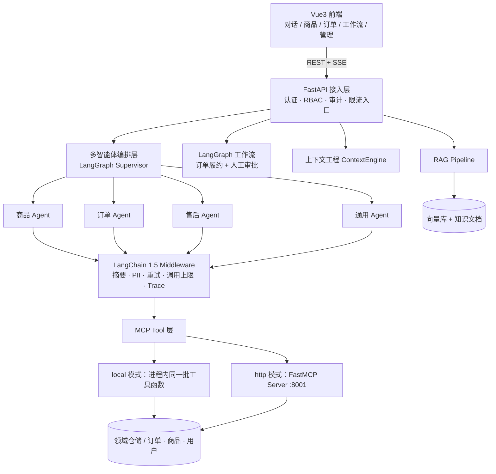

# 技术架构

## 1. 技术选型

| 层 | 技术 | 版本 / 说明 |
|---|---|---|
| 前端 | Vue 3 + TypeScript + Vite + Pinia + vue-router | SSE 流式对话、SVG 工作流可视化 |
| 后端 | Python 3.11+ / FastAPI / uvicorn | REST + SSE，Pydantic v2 校验 |
| Agent 框架 | **langchain 1.5.2** | `create_agent` + middleware（LangChain 1.x 起 agent 运行在 LangGraph 之上） |
| 编排运行时 | langgraph 1.2.x | `StateGraph`、checkpointer、`interrupt()` / `Command(resume=...)` |
| MCP | `langchain-mcp-adapters` + `mcp` FastMCP | stdio / streamable-http；官方适配器转换 MCP 工具 |
| RAG | `langchain-core` `InMemoryVectorStore` + 自建确定性哈希 Embedding | 零 API Key 可运行；向量召回 + 中文 n-gram 词面重排 |
| 可观测性 | TraceCollector + AuditLogger + Metrics(Counter/Gauge/Histogram) | 可替换为 LangSmith / OpenTelemetry |
| 评测体系 | Golden Case / Evaluator / Replay / 回归门禁 | 任务成功率、工具准确率、幻觉率、P95/P99 |
| 测试 | pytest + pytest-asyncio；Vitest + Vue Test Utils | 后端全量用例 + 前端用例 |

> 版本说明：2026-11 验证 PyPI 最新 Python 版为 `langchain==1.5.2`、`langgraph==1.2.23`。LangChain 1.x 中 v0 的 `LLMChain` / `create_react_agent` 已迁移到 `langchain-classic` 或由 `create_agent` 取代，本项目只使用 1.5 的现代 API。

## 2. 总体分层



## 3. 核心链路

### 3.1 对话请求（SSE）

1. `POST /api/chat/stream`，FastAPI 依赖解析 Bearer Token，写入 `ContextVar`（请求级身份，工具内部可读取）。
2. Supervisor 图执行：
   - `context` 节点：RAG 检索 + 工具清单 + 用户身份 + 历史滑窗，按优先级装箱，产出可解释快照；
   - `route` 节点：规则路由器将意图映射到 shopping / order / support / general；
   - 对应 specialist（`create_agent` 编译出的子图）执行模型循环与工具调用；
   - `finalize` 节点从消息序列提取最终回答。
3. 前端按 `node → route/context/tool → token → done` 顺序增量渲染，并展示工具调用与上下文快照。

### 3.2 MCP 工具

- 单一真源：`app/mcp/tools.py` 中的 8 个业务函数。
- `local` 模式（默认）：`StructuredTool.from_function` 包装同一批函数，无需额外进程，便于开发/测试。
- `http` 模式：独立 `FastMCP` 进程暴露 `http://127.0.0.1:8001/mcp`，`MultiServerMCPClient` 通过 `langchain-mcp-adapters` 转换为 LangChain 工具并注入 agent；支持 Authorization header 透传。
- 所有工具在**函数内部**再次校验权限与数据归属，避免仅依赖 LLM 自觉调用。

### 3.3 RAG

- 文档：售后、配送、优惠、发票、商品知识（8 条种子）。
- Embedding：`HashEmbeddings` 对中文 1/2/3-gram 与英文词做稳定哈希，L2 归一化；确定性、无网络依赖。
- 召回：向量相似度召回候选 → 中文 n-gram 词面重叠 + 来源命中加权重排 → Top-K。
- 注入：由 ContextEngine 以 `[检索增强知识]` 区块进入 SystemMessage，同时作为 `rag_search` 工具供 agent 按需调用。

### 3.4 上下文工程

`ContextEngine` 按优先级（角色规则 > 用户身份 > 检索知识 > 工具清单）装箱，预留用户轮与历史轮预算；历史采用滑窗 + 超长轮截断标记；LangChain 侧另配 `SummarizationMiddleware`（`trigger=("messages",14)`）做二级压缩。每次构建输出 `ContextSnapshot`，前端可直接展示各区块字符数、是否纳入/截断。

### 3.5 稳定性设计

| 关注点 | 实现 |
|---|---|
| 认证 | HMAC 签名 Token（`ECOM_SECRET_KEY`），`decode_token` 校验签名、过期与角色白名单；生产可换 OAuth2/JWT |
| 授权 | RBAC 权限矩阵（guest/customer/service/admin）+ `require_permission` 依赖 + 工具级 `filter_tools` + 函数级数据归属校验 |
| 数据隔离 | `ContextVar` 传递当前用户；customer 仅能读自己的订单，service/admin 可跨客户；越权写审计日志 |
| 人工审批 | LangGraph `interrupt()` 在履约工作流中对 ≥¥500 订单暂停，`Command(resume=bool)` 恢复 |
| 重试/降级 | `ToolRetryMiddleware` 工具重试；`SummarizationMiddleware` 上下文压缩；`ModelCallLimitMiddleware` 防死循环；离线模型保证无 Key 可用 |
| PII | `PIIMiddleware` 对邮箱脱敏、手机号掩码（输入侧） |
| 审计 | 登录、下单、退款、越权、审批均落 AuditLogger，可按 actor/decision 查询 |
| 追踪 | TraceCollector 记录节点流转、工具调用、最终答案长度；`/api/graphs` 提供图元数据供前端渲染 |
| 错误处理 | `PermissionError` → 403；业务校验 `ValueError` → 400；工具异常以 JSON error 回传模型而非崩溃 |

### 3.6 规划与推理（Planning）

`app/planning/` 提供两条执行路径：

- **ReActLoop**：以 LangGraph `StateGraph` 实现 Thought → Action → Observation 循环，带最大步数、超时与重复动作检测；产出完整 trajectory 供 Trace 与评测回放。
- **PlanAndSolveExecutor**：`PydanticOutputParser` 先把目标拆成带依赖的 `Plan`，再逐步执行；单步失败可跳过或降级，避免整任务回滚。

两者通过 `create_planning_graph(mode=...)` 统一入口，使用同一套离线模型，零 API Key 可跑。

### 3.7 三层记忆（Memory）

`app/memory/` 分离三种生命周期：

| 层 | 类 | 生命周期 | 用途 |
|---|---|---|---|
| 会话记忆 | `WorkingMemory` | thread | 多轮对话，按预算淘汰+压缩 |
| 情景记忆 | `EpisodicMemory` | user + task | 完整任务轨迹，按时间/关键词检索，带 TTL |
| 用户长期记忆 | `UserMemory` | user | profile / preferences / facts，带置信度与来源 |

`MemoryManager` 门面统一 `remember` / `recall`，返回可注入 system prompt 的 `injected_context` 与 token 估算；`forget_user` 支持合规删除。存储通过 `MemoryStore` Protocol 抽象，可换 Redis/Postgres。

### 3.8 进阶 RAG 与知识治理

- **解析切片**：`ingest.py` 支持文本/Markdown/JSON，固定长度+overlap、章节、语义段落三种策略。
- **混合检索**：`hybrid.py` 用纯 Python BM25 + 向量召回，RRF 融合后用交叉特征重排；无命中时真实返回空（不像 demo pipeline 给兜底）。
- **知识治理**：`governance.py` 提供版本化、增量索引、撤销/回滚、租户与分类隔离。
- **幻觉控制**：`citation.py` 校验引用是否落在召回集，并给答案打 groundedness 分数、列出未支撑句。
- **高阶检索**：`text2sql.py` 提供受限 SQLite SELECT 与 Text2Cypher 模板；`graphrag.py` 用邻接表建实体关系图，支持 1-2 跳子图检索。

### 3.9 沙箱、恢复与评测

- **Sandbox**：`CodeSandbox` 先 AST 静态校验再受限执行，拦截危险 import 与 dunder 属性；`CodeModeRunner` 把工具集包装成命名空间，让模型用代码编排多个工具；`Harness` 记录一次任务的完整输入输出。
- **长任务恢复**：`resume/` 每步写 `Checkpoint`，中断后按 task_id 从断点继续，幂等步骤不重复执行。
- **可观测与评测**：`metrics.py` 提供 Counter/Gauge/Histogram（P50/P95/P99）与 LangChain 回调埋点；`eval/` 支持 Golden Case 批量评测、Trace Replay 复现 Bad Case、回归门禁阻止质量退化。

## 4. 目录结构

```
backend/
  app/
    main.py                 FastAPI 入口
    config.py               ECOM_* 配置
    domain/                 实体与内存仓储（可替换 SQL）
    security/               rbac.py（权限/Token/ContextVar）、audit.py
    context/engine.py       上下文工程
    rag/                    embeddings.py、pipeline.py（基础）
                            ingest / hybrid / governance / citation / text2sql / graphrag（进阶）
    llm/factory.py          离线工具调用模型 + OpenAI 切换
    mcp/                    tools.py（工具真源）、server.py（FastMCP）
    agents/                 tools.py、specialists.py、supervisor.py
    workflows/fulfillment.py 订单履约图
    observability/          tracer.py（Trace + 图描述）、metrics.py（指标）
    planning/               ReAct / Plan-and-Solve / 规划执行
    reliability/            重试 / 超时 / 降级 / 幂等 / 终止条件
    memory/                 会话 / 情景 / 用户长期记忆
    sandbox/                AST 校验 / 受限执行 / Code Mode / Harness
    resume/                 Checkpoint / 长任务恢复
    eval/                   Golden Case / Evaluator / Replay / 回归门禁
    api/                    routes.py、schemas.py
  tests/                    pytest 用例（业务 + 知识点 + 能力补齐专项）
frontend/
  src/{api,stores,router,types,views,components}
docs/                       产品/架构/API/测试/能力矩阵/生产化文档
```

完整的能力项与状态对照见 [`CAPABILITY_MATRIX.md`](CAPABILITY_MATRIX.md)。

## 5. 生产化替换点

1. 内存仓储 → PostgreSQL/SQLAlchemy；向量库 → pgvector / Milvus。
2. `InMemorySaver` → `PostgresSaver`；ConversationStore → Redis。
3. `HashEmbeddings` → BGE / OpenAI Embeddings；离线模型 → `ECOM_LLM_PROVIDER=openai`。
4. HMAC Token → 企业 IdP（OAuth2/OIDC），并在 MCP HTTP server 前置同一套校验中间件。
5. TraceCollector / AuditLogger → LangSmith + OpenTelemetry + 集中日志。
6. API 网关增加速率限制、幂等键（下单）、请求体大小限制。

## 6. 关键设计取舍

- **多智能体而非单体巨型 Prompt**：路由确定、工具子集隔离、权限边界清晰，便于定位问题。
- **规则路由 + 规则离线模型**：保证零 Key 可运行与测试确定性；真实 LLM 只需切换环境变量，agent/middleware/workflow 代码不变。
- **工具函数单一真源**：MCP 与本地适配共用，避免两套实现漂移。
- **工具内二次鉴权**：即使模型被提示注入诱导调用越权工具，也会返回 `permission_denied` 并落审计。
