# 产品架构（双后端版）

> 版本：v2.0 ｜ 更新：2026-11-23
> 面向：产品经理、前端/后端开发、测试、演示者
> 配套：[`PRODUCT.md`](PRODUCT.md) 功能说明 · [`TECHNICAL_ARCHITECTURE.md`](TECHNICAL_ARCHITECTURE.md) 技术架构 · [`TEST_SUITE.md`](TEST_SUITE.md) 测试用例

---

## 1. 产品定位

一个**双引擎电商智能体工作台**：用户用自然语言完成商品咨询、下单、订单查询、退款与政策问答；运营/客服在后台查看智能体决策链路、工具调用、权限审计与工作流状态。

新增的产品能力是**后端引擎可切换**——同一套前端、同一套数据，可在 `Python · LangChain 1.5` 与 `Java · LangChain4j` 之间切换，用于：

1. 同一产品需求的技术栈 A/B 选型；
2. 跨语言实现一致性验证；
3. 团队按技术栈分工而用户无感。

---

## 2. 产品功能地图

```mermaid
flowchart TB
    ROOT[电商智能体工作台] --> C1[智能对话]
    ROOT --> C2[商品与订单]
    ROOT --> C3[工作流与审批]
    ROOT --> C4[可观测与治理]
    ROOT --> C5[能力实验室]
    ROOT --> C6[系统与引擎管理]

    C1 --> C1a[SSE 流式回答]
    C1 --> C1b[意图路由可视化]
    C1 --> C1c[工具调用链展示]
    C1 --> C1d[上下文快照]

    C2 --> C2a[商品搜索/库存]
    C2 --> C2b[订单隔离查询]
    C2 --> C2c[下单/退款]

    C3 --> C3a[履约状态机]
    C3 --> C3b[大额人工审批]
    C3 --> C3c[SVG 流程可视化]

    C4 --> C4a[Trace / Audit]
    C4 --> C4b[Metrics P95/P99]
    C4 --> C4c[Golden Case 评测]
    C4 --> C4d[基础设施健康]

    C5 --> C5a[ReAct / Plan-Solve]
    C5 --> C5b[混合检索]
    C5 --> C5c[三层记忆]
    C5 --> C5d[沙箱 / Text2SQL]
    C5 --> C5e[LLM-as-Judge / 轨迹评测]

    C6 --> C6a[角色与权限矩阵]
    C6 --> C6b[后端引擎切换]
    C6 --> C6c[多模型提供方]
```



---

## 3. 角色与权限

| 角色 | 典型用户 | 能做什么 | 不能做什么 |
|---|---|---|---|
| guest 访客 | 未登录 | 浏览/搜索商品、政策问答 | 查订单、下单、退款、看 Trace |
| customer 客户 | 张三、李四 | 访客能力 + 自己的订单/下单/退款 | 查他人订单、审批、管理 |
| service 客服 | 王客服 | 跨客户订单查询与退款、看 Trace/Audit | 审批大额订单、改权限 |
| admin 管理员 | 管理员 | 全部能力 + 工作流审批 + 引擎管理 | — |

演示账号密码均为 `123456`：`张三`(U001)、`李四`(U002)、`王客服`(S001)、`管理员`(A001)。

**后端切换后的权限差异**：两套后端 token 不通用，切换引擎时前端自动清除 token 并提示重新登录，避免跨系统身份串用。

---

## 4. 双引擎产品体验

### 4.1 切换入口

1. **系统管理页**：「后端引擎」卡片，两个按钮：
   - `Python · LangChain 1.5`（默认，http://localhost:8000）
   - `Java · LangChain4j`（http://localhost:8080）
   - 显示当前 baseURL 与 `GET /api/health` 探测结果（在线/离线）。
2. **顶部引擎标识**：紧凑 chip 常驻显示当前引擎，避免用户误判数据来源。
3. **部署侧切换**：nginx `UPSTREAM_BACKEND` 或挂载 `config.js`，无需重新构建前端镜像。

### 4.2 用户感知的一致性标准

切换引擎后，以下体验**必须一致**（否则视为产品缺陷）：

| 维度 | 一致性要求 |
|---|---|
| 登录 | 同样四个账号密码可登录，角色菜单一致 |
| 商品 | P001-P008 的名称/价格/库存一致 |
| 订单 | O1001-O1003 的归属/状态/金额一致；李四查 O1001 都被拒 |
| 对话 | "推荐降噪耳机" 返回 P001；"我的订单" 只返回本人订单 |
| 退款 | O1003 退款后状态 `refund_requested`，审计可查 |
| 审批 | ≥¥500 订单触发中断，管理员批准后才发货 |
| 错误 | 越权返回 403，参数错误返回 400，文案语义一致 |

### 4.3 允许的后端差异（需明确展示）

| 能力 | Python 后端 | Java 后端 | 产品处理 |
|---|---|---|---|
| 高级 Agents（A2A/RAGAS/沙箱/轨迹评测） | 完整 | 核心子集 | 能力实验室在 Java 模式下提示"该能力当前引擎暂不支持" |
| MCP stdio/HTTP | 支持 | 工具注解等效 | 对话体验一致，实现说明在详情里体现 |
| 沙箱代码执行 | 支持 | 工具白名单等效 | 界面展示差异说明 |
| 多模型切换 | DeepSeek/千问/OpenAI/离线 | DeepSeek/千问/离线 | 均在系统管理页展示可用 provider |

---

## 5. 典型用户旅程

### 5.1 主旅程（与引擎无关）

1. 张三登录 → 快捷提问"推荐降噪耳机" → 路由商品 Agent → 调用 `search_products` → 返回 P001 ¥899 库存 12。
2. "查一下 P001 库存" → 库存工具 → 有货可下单。
3. "我的订单" → `list_orders` → 只返回 U001 的 O1001 / O1003。
4. "O1003 想退货退款" → 售后 Agent 校验归属 → `initiate_refund` → 状态 `refund_requested` + 审计。
5. 切李四登录 → "查 O1001 订单" → 越权被拒 + 审计记录。
6. 管理员登录 → 工作流运行 O1001（¥1098）→ 触发审批中断 → 批准 → `shipped` → 履约完成。
7. 管理页查看 Trace / Audit / 权限矩阵 / 基础设施健康。

### 5.2 双引擎专项旅程

1. 管理员进入系统管理 → 点「Java · LangChain4j」→ 顶部 chip 变为 Java，token 被清除。
2. 重新用张三登录 → 重复主旅程第 1-4 步 → 观察回答与工具链是否与 Python 一致。
3. 进入「基础设施健康」→ 确认 MySQL/Redis/RabbitMQ/Milvus/LLM 状态。
4. 切回 Python → 再次登录 → 确认订单数据来自同一 MySQL（而非各自内存）。

### 5.3 演示脚本（建议顺序）

```text
1. Python 引擎：张三登录 → "推荐降噪耳机" → "我的订单" → "O1003 退款"
2. 管理员 → 工作流 O1001 → 审批通过 → 查看 Trace/Audit
3. 能力实验室：Plan-and-Solve / 混合检索 / 三层记忆 / 沙箱
4. 系统管理 → 切换 Java 引擎 → 重新登录 → 重跑 1-2
5. 对比两引擎回答、订单状态、审计记录
6. 查看 /api/infra/health 验证共享基础设施
```

---

## 6. 产品与知识点映射

| 产品功能 | 主要知识点 | 关联知识点 |
|---|---|---|
| 智能对话 | Agent Loop、Tool Calling | 意图路由、Context Engineering、Multi-Agent |
| 工具链展示 | MCP / Skill / Plugin | 工具 RAG、工具投毒防护、审计 |
| 工作流页 | State Machine、HITL | 长任务恢复、幂等、错误恢复 |
| 商品/订单 | 数据隔离、RBAC | MySQL 事务、Redis 缓存、行级过滤 |
| 退款 | 审计、最小权限 | RabbitMQ 事件、越权防护 |
| RAG 检索面板 | 向量召回、Rerank | Milvus、混合检索、引用质量 |
| 能力实验室 | Planning/ReAct、Memory、Sandbox | 轨迹评测、LLM-as-Judge、Token 预算 |
| Metrics/Audit | Trace、日志、Metrics | SLO 告警、P95/P99、成本 |
| 引擎切换 | 契约设计、降级 | 多模型网关、配置管理、环境隔离 |

完整知识点目录见 [`AGENT_KNOWLEDGE_MAP.md`](AGENT_KNOWLEDGE_MAP.md)。

---

## 7. 非目标与限制

1. 不接入真实支付、物流与库存中心；库存/订单是简化领域模型。
2. 默认离线规则模型用于确定性演示；真实语义理解需配置 DeepSeek/千问 API Key。
3. HMAC Token 是轻量实现，生产应换企业 IdP 并加限流与密钥轮换。
4. Java 后端的高级 Agent 能力与 Python 不完全对齐，差异已在 4.3 节列明。
5. 双后端共用同一 MySQL 时，种子脚本只应在首次初始化执行；重复执行会重置演示数据。
6. Milvus 未配置时自动回退内存向量库，界面健康状态会如实显示 `active:false`。
