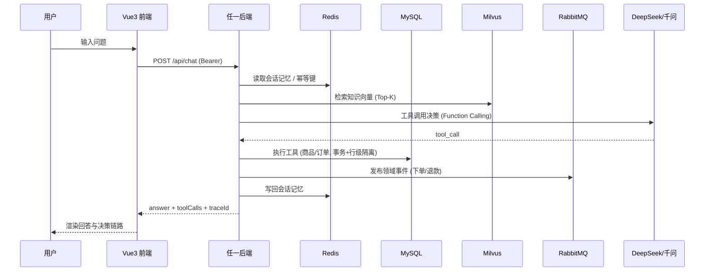
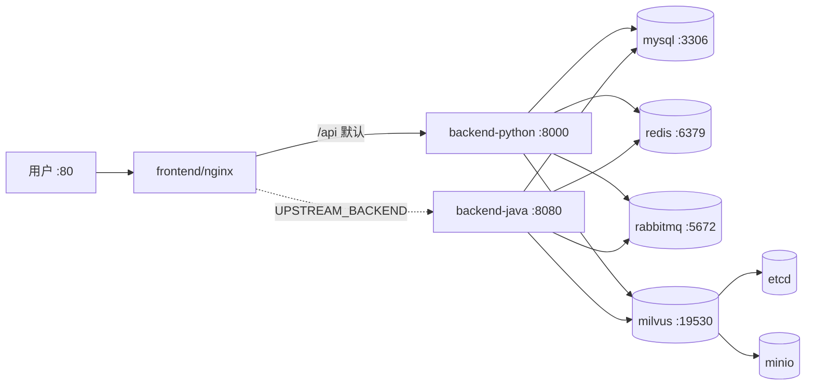

# 技术架构（双后端版）

> 版本：v3.0 ｜ 更新：2026-11-23
> 适用范围：Vue3 共用前端 + Python(FastAPI/LangChain 1.5) 与 Java(Spring Boot/LangChain4j) 双后端 + Milvus/MySQL/Redis/RabbitMQ 基础设施 + DeepSeek/千问多模型。
> 单后端细节见 [`ARCHITECTURE.md`](ARCHITECTURE.md)，能力项状态见 [`CAPABILITY_MATRIX.md`](CAPABILITY_MATRIX.md)。

---

## 1. 架构总览

一套前端、两套可互换的后端、一套共享基础设施。**前端不感知业务实现语言**，只依赖统一的 `/api` REST + SSE 契约；切换后端 = 改一个 URL。

```mermaid
flowchart TB
    subgraph FE["前端层 Vue3 + TS + Vite + Pinia"]
        UI[对话/商品/订单/工作流/管理/能力实验室]
        SW[后端引擎切换器<br/>python ⇄ java]
        UI --> SW
    end

    subgraph GW["接入层 nginx"]
        NX[/api 反向代理<br/>UPSTREAM_BACKEND 可注入/]
    end

    SW --> NX
    NX -->|"默认"| PY
    NX -->|"可切换"| JV

    subgraph PY["后端 A · Python 8000"]
        FAPI[FastAPI + uvicorn]
        LC[LangChain 1.5.2 + LangGraph 1.2.23]
        PYAGENT[Supervisor / Specialists / Middleware]
        PY -.-> LC --> PYAGENT --> FAPI
    end

    subgraph JV["后端 B · Java 8080"]
        SB[Spring Boot 3 + JDK17]
        L4J[LangChain4j 1.24.0]
        JAGENT[AiServices / @Tool / ReActRunner]
        SB -.-> L4J --> JAGENT --> SB
    end

    subgraph INFRA["共享基础设施"]
        MY[(MySQL 8<br/>商品/订单/用户/审计)]
        RD[(Redis 7<br/>会话/缓存/幂等)]
        MQ[[RabbitMQ 3.13<br/>领域事件]]
        MV[(Milvus 2.4<br/>知识向量)]
        ET[(etcd)] -.-> MV
        MN[(MinIO)] -.-> MV
    end

    FAPI --> INFRA
    SB --> INFRA

    subgraph LLM["多模型网关"]
        DS[DeepSeek API]
        QW[通义千问 API]
        OF[离线规则模型]
    end

    FAPI --> LLM
    SB --> LLM
```

### 1.1 为什么是双后端而不是迁移

| 目标 | 决策 |
|---|---|
| 保留已有 392 个 Python 测试与全部 Agent 能力 | Python 后端继续作为默认实现，不重写 |
| 验证跨语言同构能力 / 满足 Java 技术栈 | Java 后端按同一 API 契约独立实现，不是代理转发 |
| 前端零改动复用 | 统一 `/api` 前缀与响应结构；切换只改 baseURL |
| 生产可观测一致性 | 两边都暴露 `/api/health` 与 `/api/infra/health` |

---

## 2. 技术选型

### 2.1 共用技术栈

| 层 | 技术 | 版本 | 说明 |
|---|---|---|---|
| 前端 | Vue 3 + TypeScript + Vite + Pinia + vue-router | Node 22 | SSE 流式对话、SVG 工作流图、后端引擎切换 |
| 关系库 | MySQL | 8.0 | 商品/订单/用户/审计；`utf8mb4`；初始化脚本建表+种子 |
| 缓存 | Redis | 7-alpine | 会话记忆、幂等键、热点缓存 |
| 消息队列 | RabbitMQ | 3.13-management | 领域事件（下单/退款/审批），异步解耦 |
| 向量库 | Milvus | 2.4 standalone | 知识文档向量；依赖 etcd + MinIO |
| 对象存储 | MinIO | 当前稳定版 | Milvus 向量文件存储 |
| 大模型 | DeepSeek、通义千问 | OpenAI 兼容协议 | 统一 `base-url + api-key + model` 三元组接入 |
| 编排 | Docker Compose | v2 | 一条命令拉起全栈 |

### 2.2 后端 A：Python

| 组件 | 技术 |
|---|---|
| Web | FastAPI + uvicorn，Pydantic v2 |
| Agent | langchain 1.5.2 `create_agent` + middleware |
| 编排 | langgraph 1.2.23 `StateGraph` / `interrupt()` / `InMemorySaver` |
| 工具 | `mcp` FastMCP + `langchain-mcp-adapters`，stdio / streamable-http |
| RAG | `HashEmbeddings` + `InMemoryVectorStore` 回退；Milvus 适配器可切换 |
| 测试 | pytest + pytest-asyncio（392+ 用例） |

### 2.3 后端 B：Java

| 组件 | 技术 |
|---|---|
| Web | Spring Boot 3.x + JDK 17 |
| Agent | LangChain4j 1.24.0：`AiServices`、`@Tool`、`OpenAiChatModel` |
| 编排 | Spring 状态机式履约流 + ReAct 循环（最大轮次保护） |
| 工具 | LangChain4j 工具注解 + RBAC 白名单 |
| RAG | LangChain4j Milvus embedding store，未配置时内存回退 |
| 测试 | JUnit 5 + Spring Boot Test |

> 版本核实：LangChain4j 的 Maven 坐标以官方 BOM `dev.langchain4j:langchain4j-bom:1.24.0` 为准；若某个可选 artifact 在该版本不存在，以官方同版本最接近模块替代并在 `java-backend/README.md` 说明。

---

## 3. 统一 API 契约（前端共用的前提）

两套后端必须对这些路径给出**相同结构**的响应：

| 方法 | 路径 | 用途 | 成功响应要点 |
|---|---|---|---|
| POST | `/api/auth/login` | 登录 | `{ token, user:{id,name,role} }` |
| GET | `/api/health` | 存活探针 | `{ status, service }` |
| GET | `/api/infra/health` | 依赖健康 | `{ components:{mysql,redis,rabbitmq,milvus,llm} }` |
| GET | `/api/products` | 商品列表/搜索 | `Product[]` |
| GET | `/api/orders` | 订单列表（按角色隔离） | `Order[]` |
| POST | `/api/chat` | 同步对话 | `{ answer, toolCalls, traceId }` |
| GET | `/api/chat/stream` | SSE 流式对话 | `node/token/done` 事件 |

扩展契约：Python 后端额外提供 `/api/capabilities/*`（11 端点）与 `/api/frontier/*`（25 端点），覆盖规划、RAGAS、A2A、沙箱、评测等高级能力；Java 后端按同一契约实现核心子集并在 `/api/frontier/*` 逐步对齐。

**字段约定**：金额 `number`（¥）、时间 ISO-8601 UTC、ID 字符串；错误统一 `{detail: string}`。

---

## 4. 基础设施接入设计

### 4.1 统一原则：环境变量启用 + 自动回退

所有外部依赖都是**可选的**：

- 未配置 URL/Key 时，组件进入 `fallback` 状态，使用进程内实现，保证 `pytest` / `npm test` / 本地开发零依赖可跑；
- 配置后走真实客户端，健康检查如实上报 `configured / active / backend / detail`；
- 回退不是"假装成功"——`/api/infra/health` 会明确标注 `active:false` 与原因。

### 4.2 Python 侧 `app/infra/`

| 模块 | 真实实现 | 回退 | 关键环境变量 |
|---|---|---|---|
| `mysql_repo.py` | `pymysql` 直连，接口对齐 `InMemoryRepository` | not_configured | `ECOM_MYSQL_URL` |
| `redis_cache.py` | `redis-py`，带 TTL | 进程内 dict + TTL | `ECOM_REDIS_URL` |
| `rabbitmq.py` | `pika` 发布领域事件 | 内存队列（可 drain 断言） | `ECOM_RABBITMQ_URL` |
| `milvus_store.py` | `pymilvus` 向量增删查 | `InMemoryVectorStore + HashEmbeddings` | `ECOM_MILVUS_URL` / `ECOM_MILVUS_TOKEN` |
| `llm_gateway.py` | `ChatOpenAI(base_url=...)` 接 DeepSeek/千问 | `RuleBasedChatModel` | `ECOM_LLM_PROVIDERS` / `ECOM_DEEPSEEK_API_KEY` / `ECOM_QWEN_API_KEY` |
| `health.py` | 聚合上述状态 | — | — |

**接线方式**（已实际接入数据路径，不只是健康检查）：
- `domain/repository.py::get_repository()` 在 `ECOM_MYSQL_URL` 存在且驱动可用时返回 `MySQLRepository`，否则原内存仓储；
- `rag/pipeline.py::RAGPipeline.__init__` 在 `ECOM_MILVUS_URL` 存在且驱动可用时把 `store` 换成 `MilvusVectorStore`，否则原内存向量库；
- `llm/factory.py::get_model()` 在 `ECOM_LLM_PROVIDERS` 含外部供应商时走 `LLMGateway`。

新增 `/api/infra/health`、`/api/infra/providers`、`/api/infra/events`、`/api/infra/cache` 端点，权限沿用现有 RBAC。

### 4.3 Java 侧

`application.yml` 全部用 `${ENV:default}` 占位，例如：

```yaml
spring:
  datasource:
    url: ${MYSQL_URL:jdbc:mysql://localhost:3306/ecom}
  data:
    redis:
      host: ${REDIS_HOST:localhost}
  rabbitmq:
    host: ${RABBITMQ_HOST:localhost}
langchain4j:
  open-ai:
    chat-model:
      api-key: ${DEEPSEEK_API_KEY:}
      base-url: ${DEEPSEEK_BASE_URL:https://api.deepseek.com/v1}
      model-name: ${DEEPSEEK_MODEL:deepseek-chat}
```

未配置数据源时使用 H2 / 内存仓储启动；LLM 无 Key 时返回规则答案，与 Python 侧行为对齐。

### 4.4 数据流



---

## 5. 多模型接入

### 5.1 提供方抽象

`ModelProvider(name, display_name, base_url, api_key, model, temperature)`：

| provider | 默认 model | base-url |
|---|---|---|
| `deepseek` | `deepseek-chat` | `https://api.deepseek.com/v1` |
| `qwen` | `qwen-plus` | `https://dashscope.aliyuncs.com/compatible-mode/v1` |
| `offline` | `rule-based` | —（无需网络） |

两套后端都提供 `list_providers()` / `get_provider()` / `create_chat_model()` 三件套；默认 `offline` 保证零 Key 可跑，配置 `ECOM_LLM_PROVIDERS=deepseek,qwen` 后按 `ECOM_LLM_DEFAULT_PROVIDER` 选择默认。

### 5.2 模型路由与成本

- `app/llm/benchmark.py` 的 `ModelProfile` 记录质量分、`cost_per_1m`、P99 延迟；
- `select_model(profiles, requirements)` 按需求加权决策，输出可读选型理由；
- `app/llm/reasoning.py` 为 o1/R1 类模型生成 `reasoning_effort` 参数，普通模型用 temperature；
- `app/llm/factory.py::get_model()` 已接入网关：`ECOM_LLM_PROVIDERS` 含非 offline 提供方时走网关创建模型，无 Key / 无 SDK 自动回退离线模型，旧 `ECOM_LLM_PROVIDER=openai` 保持兼容；
- API Key 不落代码、不进日志，生产用密钥环轮换（`app/reliability/secrets.py`）。

---

## 6. Agent 能力在双后端的映射

| 知识点 | Python 实现 | Java 实现 |
|---|---|---|
| Agent Loop | LangGraph `create_agent` + middleware | `AiServices` / `ReActRunner` |
| Planning / ReAct / Plan-and-Solve | `app/planning/` | `ReActRunner` + 计划模板 |
| Tool / Function Calling | `StructuredTool` + MCP | `@Tool` + LangChain4j |
| MCP / Skill / Plugin | FastMCP stdio/HTTP | 工具注册表（协议适配预留） |
| Workflow / State Machine | `StateGraph` + `interrupt()` | 履约状态机 + 审批端点 |
| Multi-Agent | Supervisor + 4 specialists | Supervisor + 3 specialists |
| HITL | `interrupt()` + `Command(resume)` | 审批端点 + confirm 参数 |
| Memory | 三层 Memory + Checkpoint | Redis `MessageWindowChatMemory` |
| Context Engineering | 优先级装箱 + 快照 | `ContextBuilder` token 预算 |
| RAG | 哈希向量 + Milvus 适配器 | Milvus embedding store |
| 错误恢复 | `app/reliability/` 全套 | `RetryHelper` + 幂等 + 降级 |
| Sandbox / Code Mode | `app/sandbox/` | 预留（Java 侧以工具白名单替代） |
| Trace / Metrics / 评测 | `observability/` + `eval/` | `TraceContext` + `Metrics` |
| 安全与对齐 | `security/{injection,moderation,tool_guard}` | `InjectionScanner` + RBAC + 审计 |

> 双后端能力并非逐行等价：Python 侧覆盖全部高级能力（含沙箱、A2A、RAGAS、轨迹评测），Java 侧聚焦核心链路与生产基础设施。差异表见 [`PRODUCT_ARCHITECTURE.md`](PRODUCT_ARCHITECTURE.md)。

**契约对齐的实测修正**（9 条一致性用例全通过）：

- Java 种子数据与 Python/MySQL 完全一致：P001-P008、U001/U002/S001/A001、O1001-O1003；
- Java 登录同时接受显示名（张三）与用户 ID（U001）；Python 登录响应增补嵌套 `user` 对象并保留扁平字段；
- Java 离线模式下由 `OfflineToolFallback` 按关键字直接调用 `@Tool`（新增 `getOrder` 带归属校验），使“推荐商品/我的订单/查订单/退款/下单”与 Python 行为一致；
- 显式订单号一定走 `getOrder` 作用域校验，避免用“列自己的订单”掩盖越权访问。

---

## 7. 部署拓扑



- 容器网络内部用服务名互访，宿主机只暴露必要端口；
- nginx 用 `envsubst` 模板注入 `UPSTREAM_BACKEND`，可在不重建前端镜像的情况下切后端；
- `frontend/public/config.js` 也可挂载替换，供浏览器端直接指定 API baseURL；
- 所有服务配 healthcheck + `restart: unless-stopped`；MySQL/Milvus/MinIO 数据走命名 volume。

启动与运维脚本见 `scripts/`：

```bash
cp .env.example .env      # 按需填写 API Key 与口令
./scripts/deploy.sh       # build + up -d
./scripts/smoke.sh        # 全链路健康冒烟
./scripts/logs.sh backend-python
./scripts/stop.sh
```

---

## 8. 环境变量速查

| 变量 | 默认 | 用途 |
|---|---|---|
| `ECOM_LLM_PROVIDERS` | `offline` | Python 启用的模型提供方列表 |
| `ECOM_LLM_DEFAULT_PROVIDER` | `offline` | Python 默认模型 |
| `ECOM_DEEPSEEK_API_KEY` / `ECOM_QWEN_API_KEY` | 空 | 对应厂商密钥 |
| `ECOM_MYSQL_URL` / `ECOM_REDIS_URL` / `ECOM_RABBITMQ_URL` / `ECOM_MILVUS_URL` | 空 | Python 基础设施（空=回退） |
| `MYSQL_URL` / `REDIS_HOST` / `RABBITMQ_HOST` / `DEEPSEEK_API_KEY` | 见 application.yml | Java 基础设施与模型 |
| `UPSTREAM_BACKEND` | `backend-python:8000` | nginx `/api` 上游 |

完整清单见根目录 `.env.example`。

---

## 9. 关键取舍与已知限制

1. **契约稳定优先**：两套后端独立实现但共享契约，避免"Java 只是 Python 代理"的假双后端。
2. **回退不是伪装**：所有基础设施在健康检查里如实标注回退状态，便于监控发现。
3. **离线模型默认**：无 Key 也能跑通全链路；真实语义理解需配置 DeepSeek/千问。
4. **模型训练不在范围内**：SFT/LoRA/DPO/RLHF、vLLM 等属训练/推理基础设施，本项目通过可替换适配点接入，不伪称实现。
5. **Java 侧沙箱/A2A/RAGAS 等高级能力未对齐**，以工具白名单和审计日志作为等效安全控制。
6. **Milvus standalone 依赖 etcd + MinIO**，本地无 Docker 时自动回退内存向量库。
